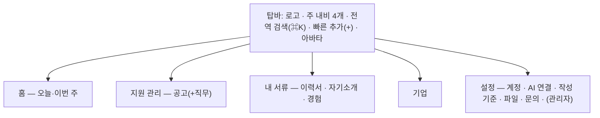

# UI/UX 재설계 계획 (2026-11-04)

> 상태: **계획, 미구현**(2026-11-04 PR #24 리뷰 반영). 근거는 [서비스 이용 흐름](../../service-user-flows.md)과 [디자인 시스템](../../design-system.md). 아래 배치와 빈도는 제안이며 사용자 검증 전이다. 구현 전에 관련 "결정 필요" 를 닫고 단계별 설계 문서(`docs/02-design/features/ui-ux-redesign.design.md`)를 쓴다. 이번 PR 은 현재 흐름 안내와 계획만 고치며 새 화면·API·DB·배포는 포함하지 않는다.

## 1. 목적

지금 화면은 **"목록은 핵심만, 나머지는 클릭해서 본다"**(design-system 목적)를 따른 결과, 모든 기능이 같은 무게로 나열되고 자주 쓰는 동작이 숨어 있다. 사용 빈도와 중요도에 따라 **접근 레이어를 다시 나누고**, 자주 하는 일은 한 번에 보이고 한 번에 끝나게 한다.

## 2. 지금 화면의 관찰과 개선 가설

현재 경로·컴포넌트 동작은 코드로 확인했다. "매일 쓴다", "발견하기 어렵다", "무겁다"는 사용성 가설이며 이용 빈도·완료 시간·오류율은 R0 전까지 미측정이다. 이를 근거로 화면 제거·접근성 저하를 먼저 확정하지 않는다.

| # | 문제 | 근거 |
|---|---|---|
| D1 | **상단 탭 6개가 같은 무게.** 매일 쓰는 지원 관리와 가끔 쓰는 기업 조사가 나란히 있다 | 탑바 세그먼트(design-system 규칙 1) |
| D2 | **홈이 칸반뿐.** "오늘 마감·내일 면접·결과 미기록·재검토 필요"를 한눈에 볼 곳이 없다 | `/` = PostingBoard |
| D3 | **숨은 조작.** 수정 진입·화면 이동이 더블클릭/Enter, 상태 변경이 드래그 위주. 처음 쓰는 사람은 발견하기 어렵다 | 규칙 4·5 |
| D4 | **값 수정이 무겁다.** 한 칸을 고쳐도 드로어 보기 → `수정` → 폼 전체 → 저장. 520px 고정 폭이라 폼이 길고 좁다 | 규칙 4, 함정 "드로어 520px" |
| D5 | **검색·필터가 화면마다 다르거나 없다.** 공고·기업 검색 없음, 직무는 화면 안 필터, 자소서만 서버 검색. 전역 검색 없음 | 화면 조사 |
| D6 | **같은 대상이 두 화면에.** 직무는 공고의 일부인데 별도 탭이고 단독 추가가 안 된다 | `/positions` |
| D7 | **관리성 기능이 업무 화면에 섞임.** 첨부 서랍(이력서 목록), 작성 기준(자소서 상단), 관리자 요청(전 화면 떠 있는 버튼), 플러그인 안내(☰ 메뉴) | 화면 조사 |
| D8 | **서류 3종(이력서·자기소개·경험)의 관계가 안 보인다.** 연결이 이력서 편집기 아래, 자소서 칩, 경험 서랍에 흩어져 있다 | 흐름 6·7·10절 |
| D9 | **이력서 편집기가 긴 한 페이지.** 기본정보와 내용 섹션 8개를 스크롤로 이동, 상단 탭 이동 시 미저장 변경을 묻지 않고 잃음, 409 자동 복구 없음 | 흐름 18절 |
| D10 | **피드백이 약하다.** 저장 성공·실패가 위쪽 알림 한 줄, 충돌(409) 처리 방식이 화면마다 다름 | 흐름 8절 |
| D11 | 404 없음, 빈 상태 안내가 화면마다 다름 | 흐름 18절 |

## 3. 기능별 빈도·중요도와 배치 레이어

아래 빈도는 초기 가정이다. R0 에서 웹 직접 입력과 AI 작성 후 검수 흐름을 각각 확인한다. 경험 원본·AI 기록 검토는 중앙 관리의 핵심이므로 "가끔"이라는 가정만으로 깊은 메뉴에 숨기지 않는다. 측정 뒤 사용자와 배치를 정한다.

| 레이어 | 위치 | 들어갈 것 |
|---|---|---|
| **L1 상시** | 주 내비·홈·전역 검색·빠른 추가 | 매일 쓰고 놓치면 안 되는 것 |
| **L2 화면 주 동작** | 화면 헤더·카드 위 직접 조작 | 그 화면에 온 이유인 동작 |
| **L3 상세** | 상세 패널·탭 | 가끔 보는 세부, 연결 관리 |
| **L4 설정·메뉴** | 설정 화면, 계정 메뉴 | 드물게 쓰는 관리·환경 |

| 기능 | 빈도 | 중요도 | 지금 | 새 레이어 |
|---|---|---|---|---|
| 오늘 할 일(마감·전형 일정·결과 미기록·재검토 필요) | 매일 | 상 | 없음 | **L1 홈** |
| 공고 상태 변경 | 매일 | 상 | 드래그·서랍 select | **L2 카드에서 바로**(드래그 + 보이는 상태 메뉴) |
| 공고 추가 | 주 | 상 | 헤더 버튼 | **L1 빠른 추가** + L2 |
| 전형 단계 완료 체크 | 주 | 상 | 서랍 안 노드 | **L2 카드에 다음 단계 표시·체크** |
| 공고·기업·서류 찾기 | 매일 | 상 | 화면마다 다름 | **L1 전역 검색**(Ctrl/⌘+K) + L2 화면 필터 |
| 이력서 편집 | 주 | 상 | 전체 페이지 | L2(편집기 개편, 6.4) |
| 자소서 작성·검색 | 주 | 상 | 카드 목록 | L2(목록·편집 2단) |
| 경험 정리·가져오기 | 가끔 | 중 | 경험 탭 | L2 "내 서류" 안 |
| 직무 상세 | 주 | 중 | 별도 탭 | **L3 공고 상세 안 탭**(독립 탭 제거, 직무 찾기는 전역 검색) |
| 기업 조사·뉴스 | 가끔 | 중 | 탭 | L1 내비 끝(낮은 무게) |
| 참고 정보 | 가끔 | 하 | 직무 서랍 스트립 | L3 |
| 제출 기록 확인 | 가끔 | 중 | 공고 서랍 | L3 + 홈 "확인 안 한 제출" |
| 첨부 파일 관리 | 드묾 | 하 | 이력서 목록 서랍 | **L4 설정 > 파일** |
| 작성 기준 | 드묾 | 중 | 자소서 상단 접힘 | **L4 설정 > 작성 기준** (+ 자소서 편집기에 "기준 보기") |
| AI 연결 안내 | 드묾 | 중 | ☰ 메뉴 | **L4 설정 > AI 연결** |
| 닉네임·로그아웃 | 드묾 | 하 | 아바타 메뉴 | L4 계정 메뉴(유지) |
| 관리자 요청·피드백 | 드묾 | 하 | 전 화면 떠 있는 버튼 | **L4 계정 메뉴 > 문의·피드백**(안 읽은 답변은 아바타 배지) |
| 관리자 콘솔 | 드묾(관리자) | 중 | ☰ 메뉴 | L4 설정 > 관리자(ADMIN만) |

## 4. 새 정보 구조

- 주 내비 **4개**(홈 · 지원 관리 · 내 서류 · 기업). 설정은 아바타 메뉴와 `/settings`.
- "내 서류" 는 하위 탭 3개와 **관계 보기**(어떤 이력서가 어떤 경험·자소서를 쓰는지)를 묶는다(D8).
- **전역 검색**: 공고·기업·직무·이력서·자소서·경험을 한 입력으로 찾는 목표다. 첫 범위는 이름·제목·문항의 키워드 찾기이며, 문항 맥락으로 사건을 고르는 의미 검색(4c-1)은 별도다. 종류별로 묶고 Enter 로 상세를 연다. `SelfIntroductionBoard` 는 현재 `focus` 를 받지 않으므로 그 처리를 R2 에 포함한다.
  - **조회 부작용부터 막는다.** 현재 `GET /api/postings` 와 `?archived=true` 모두 자동 보관을 실행한다(`JobPostingService.findOpen/findArchived`). 검색창을 열거나 타이핑할 때 이 목록 호출을 재사용하지 않는다. 공고 검색은 자동 보관을 호출하지 않는 소유자 범위의 읽기 전용 조회가 선행 조건이다.
  - 기존 API 는 종류마다 검색·쪽 나누기·본문 크기가 다르다. 첫 전역 검색에는 가벼운 조회 계약이 필요하며 **R2 백엔드 범위**다. 결과는 종류·id·제목·부모 표시·이동 대상·수정 시각 정도로 제한하고 이력서 JSON·자소서 답변 전문·첨부 바이트를 전부 미리 받지 않는다. 종류별 최대 5개·전체 최대 30개, 더 있으면 "더 보기"로 해당 화면을 연다. 정확한 경로·DTO 는 R2 설계에서 정한다.
  - 일부 종류만 받은 상태를 "전체 검색 결과 없음"으로 표시하지 않는다. 미조회·조회 실패·결과 없음과 상한을 구분하고 늦은 이전 질의 응답은 버린다. 계정 변경/로그아웃 때 결과를 비운다. 같은 문자열이 있는 다른 계정 결과는 반환하지 않는다.
- **빠른 추가(+)**: 공고 · 기업 · 이력서 · 자소서 문항 · 경험.
- **경로 호환**: 지금 경로(`/`, `/positions`, `/companies`, `/resumes`, `/introductions`, `/experiences`, `/plugin`, `/admin`)와 `?focus=` 링크는 계속 열려야 한다(공유·북마크). **대상 화면이 완성된 단계에서만** 옛 경로를 새 위치로 보낸다. R1 은 기존 진입점을 유지하고 이동 보호를 먼저 넣는다. 경로 변경은 AGENTS 불변 조건 3(세 곳 동시 갱신)과 로그인 왕복 검증을 따른다.
  - **`/` 는 뜻이 바뀐다.** 지금 공고 상세는 `/?focus=<공고id>` 이고 직무·기업 화면이 이 주소로 공고를 연다(`App.vue` `open-posting`). 홈이 대시보드가 되면 `/?focus=` 는 지원 관리로 보낸다.
  - **`/plugin` 은 공개 페이지로 남긴다.** 로그인 검사 전에 그려지는 연결 안내이고 MCP 지침이 이 경로를 가리킨다. 설정 > AI 연결은 이 페이지로 가는 링크다.
  - **관리자 화면을 옮기면 nginx `auth_request` 게이트도 새 경로에 건다**(지금은 `location = /admin` 에만 있다). 데이터 보호는 `/api/admin/**` 가 맡지만 지금 있는 한 겹을 잃지 않는다.
  - 라우터 라이브러리가 없다(`App.vue` 가 pathname 분기, 모르는 경로는 마지막 `v-else` 인 공고 화면). 이동·404·미저장 보호는 `navigate()` 와 `popstate` 두 입구에서 처리한다.
  - `/positions?focus=<직무id>` 는 부모 공고를 확인한 뒤 **같은 직무**를 선택해서 연다. `/positions` 의 전체 직무 찾기·기업별 비교·관심/진행/보관 필터도 대체 경로가 준비돼야 한다. 전역 검색 결과 하나만으로 기존 목록 기능을 대체했다고 보지 않는다. 삭제됐거나 남의 id 는 미존재 안내이며 첫 공고/첫 직무로 임의 대체하지 않는다.

## 5. 공통 상호작용 원칙

1. **보이는 조작이 기본, 제스처는 지름길.** 더블클릭·드래그는 남기되 같은 일을 하는 버튼·메뉴를 항상 둔다(D3).
2. **한 칸 고치기는 그 자리에서.** 상태·마감일·전형 결과·태그·짧은 텍스트는 상세에서 바로 편집(Enter 저장/Esc 취소). 긴 폼 전환은 여러 칸을 고칠 때만(D4).
   **동시 수정 조건**: 공고·기업·직무 수정은 `expectedVersion` 없는 전체 교체 PUT 이다. 저장 직전 GET 을 해도 그 GET 과 PUT 사이의 변경을 놓친다. **재조회는 충돌 방지책으로 인정하지 않는다.** 전체 PUT 으로 인라인 즉시 저장을 추가하려면 읽은 버전과 쓰기를 서버가 원자적으로 비교하는 조건부 저장이 선행해야 한다. 준비 전에는 그 칸의 즉시 저장을 열지 않는다. 기존 명시 저장에도 같은 위험이 있음을 기록하며 UI 를 바꾸는 것만으로 해결됐다고 하지 않는다.
   상태·전형 결과 전용 동작은 변경 범위가 작지만 같은 필드의 동시 변경까지 검출하지는 않는다. 특히 전형은 `seq` 가 식별자라 재정렬 뒤 옛 순번으로 누르지 않게 단계 정체성·버전 계약을 먼저 정한다. 단순 재시도·되돌리기로 제출 기록을 중복 생성하거나 다른 전형을 바꾸지 않는다.
3. **상세는 넓게.** 520px 고정 드로어 → **분할 보기**(목록 + 상세, 폭 조절). 좁은 화면은 전체 화면 상세.
4. **같은 검색·필터 막대.** 화면마다 [검색 · 필터 칩 · 정렬 · 보기 전환]을 같은 자리·같은 모양으로(D5).
5. **저장 피드백 통일.** 성공은 토스트, 실패·충돌은 그 자리에. `*_STALE` 은 초안을 보존하고 "최신 보기 / 내 입력 복사"를 제공한다. **409 전체를 같은 오류로 취급하지 않는다**: BUSY 는 대기 안내, IN_USE 는 사용처 안내, STALE 은 버전 충돌이다. 최신 version 만 받아 옛 초안을 자동 재전송하지 않는다. "내 변경 다시 적용"은 최신값과 충돌을 보여 준 뒤 사용자가 고른 필드만 새 version 으로 저장하는 별도 작업이다.
   되돌리기 **제외**: 삭제(연결까지 지우는 영구 삭제라 `ConfirmDialog` 유지), "제출 완료"로의 상태 변경(제출 기록 LINKED 가 남아 상태만 되돌리면 기록과 어긋난다).
   첫 버전의 되돌리기는 **저장 전 초안 취소**만 지원한다. 서버에 저장한 값을 되돌리는 토스트는 쓰기 버전/대상 정체성을 확인할 수 있을 때 별도 설계한다. 저장 전 문서 전체를 다시 PUT 하는 되돌리기는 금지한다.
6. **미저장 변경 보호는 초안 교체까지 포함한다.** `navigate()`·뒤/앞으로 가기·새로고침뿐 아니라 같은 경로의 `?focus=A→B`, 내 서류 하위 탭, 목록의 다른 항목 선택, 드로어 닫기·Escape, 취소/새 문항 만들기·로그아웃을 포함한다. 폼이 dirty·저장 중 상태를 공통 보호에 알리고 **이동 승인 전에는 초안을 초기화하거나 폼을 unmount 하지 않는다.** 저장 성공한 초안만 깨끗한 상태로 바꾸고 실패/409 때는 보존한다.
   `popstate` 는 URL 이 이미 바뀐 뒤 온다. preventDefault 만으로 취소할 수 없으므로 승인 전 화면 교체를 보류하고, 취소하면 URL·history 위치도 원래 항목으로 되돌리는 계약과 뒤/앞 반복 테스트가 필요하다. 브라우저 이탈은 dirty 일 때 beforeunload 기본 경고를 쓰되 모바일 강제 종료까지 보존한다고 주장하지 않는다. 로컬 자동 저장·개인정보 영구 캐시는 이번 범위 밖이다.
7. **빈 상태는 다음 행동을 알려 준다**, 404 화면을 둔다(D11).
8. **키보드·접근성.** 모든 동작 Tab 도달, 포커스 표시, 단축키(⌘K 검색, N 새로 만들기, ? 도움말 — 한 글자 단축키는 입력칸 안에서 꺼지고 설정에서 끌 수 있게, WCAG 2.1.4), 색만으로 상태를 구분하지 않기, 터치 대상 44px.

## 6. 화면별 방향

- **6.1 홈(신규)**: 마감 D-7 안 관심·작성 중, 다가오는 전형 일정, 결과 미기록 전형, 확인 안 한 제출, 재검토 필요 서류, AI 기록 검토 대기. 항목마다 바로 하는 버튼. 마감·전형 일정·결과 미기록은 [MCP Events E0 `ApplicationAlarms`](../../mcp-events.md) 와 같은 읽기 전용 계산을 쓴다. E0 는 아직 설계이고 범위가 공고·전형뿐이라 나머지는 홈 집계에서 더한다. `ResumeSummary` 에 needsReview 가 없어 홈 집계 엔드포인트가 필요하며 이력서별 전체 조회 반복으로 대체하지 않는다. **공유 계산만 재사용하고 웹훅 구독·발송(E1/E2)은 홈의 선행 조건이 아니다.** 조회가 자동 보관·제출 확인·AI 기록 확정을 실행하면 안 된다.
- **6.2 지원 관리**: 칸반 / 표 보기 전환, 표는 정렬·필터(상태·마감·기업·고용형태). 카드: 기업 · 모집 부문 · D-day · **다음 전형 단계** · 상태 메뉴. 상세(분할): 개요 · 전형 · **직무 탭**(직무 화면 흡수, 해당 공고 안에 직무 추가) · 제출 기록 · 메모. 공고 없는 고아 직무를 만드는 기능은 아니다.
- **6.3 기업**: 검색·업종 필터·"진행 중 공고 있음" 필터. 상세: 개요 · 공고 · 뉴스/유튜브.
- **6.4 이력서 편집기**: 왼쪽 **섹션 목차**(앵커 이동, 행 수·재검토 필요·미연결 표시), 섹션 접기, 아래 고정 **저장 막대**(변경 수·저장·초안 취소), 지원 직무·첨부·자소서 연결은 오른쪽 보조 패널. 충돌 시 5절의 초안 보존 규칙을 쓴다. 현재 "원본으로 갱신"은 행 문구를 바꾸지 않고 다음 저장 때 근거 개정만 올린다. 새 UI 에서 문구까지 교체된다고 안내하지 않는다.
- **6.5 자기소개**: 왼쪽 목록(필터: 문항 유형·지원 직무·출처 미상·AI 기록) + 오른쪽 편집기, 글자 수, "작성 기준 보기"·"쓴 경험" 패널.
- **6.6 경험**: 목록(필터: 종류·AI 기록·재검토 필요) + 상세, 가져오기는 **단계형 마법사**, 상세에 "쓰는 곳"(이력서 행·자소서) 표.
- **6.7 설정(신규 `/settings`)**: 계정 · AI 연결(공개 `/plugin` 링크) · 작성 기준 · 파일(지금 첨부 서랍) · 문의·피드백(지금 요청 위젯) · 관리자(ADMIN, 지금 `/admin`). 웹 로그인 여부를 외부 AI 클라이언트의 연결 성공으로 표시하지 않는다. 클라이언트별 연결 상태 진단은 별도 요구가 있을 때 설계한다.

## 7. 디자인 시스템 개정 (되돌릴 기존 규칙)

| 지금 규칙(design-system.md) | 바꿀 방향 | 이유 |
|---|---|---|
| 1 탑바 세그먼트 6개 | 주 내비 4개 + 설정 | D1 |
| 2 얇은 헤더 + 카드/칸반만 | 공통 헤더(제목 · 검색/필터 막대 · 주 동작) | D5 |
| 3 카드는 핵심만 | 유지하되 "다음 행동"(다음 전형·상태 메뉴)은 카드에 | D2·D3 |
| 4 상세·수정은 520px 드로어 | 분할 보기 + 인라인 편집 | D4 |
| 5 종속 데이터는 더블클릭 | 보이는 링크/버튼 + 더블클릭 지름길 | D3 |
| 9 관리자 요청 우측 하단 고정 버튼 | 계정 메뉴·설정으로 | D7 |

색·라운드 토큰은 유지하고 타이포 스케일·간격·밀도 토큰, 아이콘 세트, 토스트·분할 패널·인라인 편집·필터 막대·명령 팔레트 컴포넌트를 더한다. 되돌리는 규칙은 `docs/decisions.md` 에 이유를 적는다.

## 8. 단계

| 단계 | 내용 | 끝 조건 |
|---|---|---|
| R0 진단 | 9절 과업 8개와 아래 회귀 과업을 **본인 전용 로컬 시드 계정·독립 DB**에서 측정. 8088/8089 라는 포트만으로 운영과 분리됐다고 판단하지 않고 Compose 프로젝트·DB 연결을 확인한다. 계정·자료 초기 상태를 고정 | 전후 기준표·원시 시도 결과·측정 환경. 현재 미측정 |
| R1 초안 보호·설정 진입 | 전역 미저장 보호(5절 6), 404·설정 껍데기와 링크. 기존 주 내비·목록·공개 plugin·admin 경로를 유지한다. 관리 기능 이전도 대체 화면이 동등하게 동작할 때만 | 경로/동일 화면/닫기/로그아웃의 취소 후 초안·URL 보존, 기존 링크·로그인·smoke |
| R2 공통 컴포넌트·검색 | 헤더·필터·토스트·분할·오류 처리·명령 팔레트, 읽기 전용 요약 검색 계약과 자소서 focus. 인라인은 초안 편집부터, 즉시 저장은 조건부 쓰기 준비 뒤에만 | 검색의 자동 보관 0건·계정 격리·응답 상한·늦은 응답/부분 실패, 컴포넌트·접근성 검사 |
| R3 지원 관리 | 칸반/표, 상태 메뉴·다음 전형, 직무 상세와 전체 직무 찾기 대체 경로. 직무 정체성·전형 변경·기존 연결·마지막 직무 삭제 경고 보존 | 과업 1~3과 `/positions` 목록·focus 호환. 여기까지 통과해야 기존 직무 주 내비 축소 가능 |
| R4 홈 | 읽기 전용 ApplicationAlarms 공유 계산 + 웹 홈 집계. 웹훅 수신·발송과 분리. 이 단계에서 홈과 `/?focus=` 호환을 함께 전환 | 과업 4, 조회 전후 상태 불변·날짜 경계·일부 집계 실패 표시 |
| R5 내 서류 | 이력서 목차·저장 막대, 자소서 2단, 경험 목록·마법사·관계 보기 | 과업 5~7 |
| R6 기업·최종 배치 | 기업 필터·탭, 빈 상태, 반응형·키보드 점검. R3~R5 대체 화면과 사용자 결정이 준비된 뒤 주 내비 4개를 최종 활성화 | 과업 8·회귀표, 기능 누락 0건·옛 링크·키보드/터치·전 화면 점검 |

단계마다 별도 PR 로 내고 완료한 화면부터 전환한다. 백엔드 변경이 필요한 경계는 **R2 요약 검색, 인라인 즉시 저장 전 조건부 쓰기, 전형 순번 대신 안전한 대상 확인, R4 홈 집계**다. 이를 "화면만 변경"으로 추정하지 않는다. 기존 도메인·연결·확정 의미는 유지하고 정확한 API/마이그레이션은 각 단계 설계에서 정한다. 프런트 변경은 type-check·test, 백엔드 변경은 저장소 필수 컴파일/통합 검사, 모든 변경은 smoke 를 확인한다. 실제 UI 변경 단계에서 EGO 과업을 다시 잰다.

## 9. 검증 과업 (전후 같은 과업)

1. 새 공고를 기업과 함께 등록하고 직무 2개·전형 3단계를 넣는다.
2. 공고 하나를 "제출 완료"로 옮기고 실제로 낸 이력서를 확인 기록한다.
3. 1차 면접 단계를 완료로 체크한다.
4. 이번 주 마감 공고와 내일 일정을 찾는다.
5. 이력서의 프로젝트 행 하나를 경험에서 불러오고 저장한다.
6. 협업 문항 자소서를 새로 쓰고 이력서·지원 직무·쓴 경험을 연결한다.
7. 재검토 필요가 뜬 이력서 행을 찾아 원본으로 갱신한다.
8. 특정 기업의 뉴스 링크를 추가하고 그 기업의 진행 중 공고를 연다.

측정: 클릭·이동 수와 **정확한 최종 상태까지 완료했는지**를 함께 센다. 과업별 같은 시드·계정 역할·화면 크기·초기 URL·자료량·네트워크 조건을 고정하고, 예열 후 동일 과업을 최소 3회 실행해 개별 결과·중앙값·막힌 지점을 기록한다. 3회 표본을 p95 나 전체 사용자 만족도로 표현하지 않는다. R0 기준선과 목표를 정한 뒤 구현하며 지금은 수치가 없다. 운영의 로그인된 공고 목록 GET 도 자동 보관을 일으키므로 "읽기처럼 보이는" 성능/사용성 시험에 사용하지 않는다.

**필수 회귀표** — 구현 단계의 통과 조건이며 이번 문서 PR 에서 통과했다고 주장하지 않는다.

| 사례 | 통과 조건 |
|---|---|
| 미저장 이력서 A → 탑바/검색 결과 B/같은 경로 focus B/뒤·앞/닫기/Escape/로그아웃 | 취소 시 초안·version·선택 대상·URL·history 보존. 승인하면 의도한 항목만 열림. 뒤·앞 반복으로 history 항목을 추가하지 않음 |
| 자소서·경험·작성 기준 편집 중 다른 항목 선택, 저장 실패·STALE | 같은 보호 적용, 실패 후 입력 복사 가능. 새 version 으로 옛 문서 자동 재전송 0건 |
| 인라인 저장 직전 GET 후 AI 가 같은 문서를 수정 | 원자적 조건부 쓰기는 충돌을 반환하고 AI 수정·내 초안 보존. GET→PUT 만 있는 구현은 실패 |
| 검색창 열기·검색·홈 진입, 마감 지난 관심 공고 포함 | 저장 전후 보관·지원 상태·제출 기록·검토 확정 값이 같음. 전용 읽기 경로 사용 |
| 전형 재정렬/삭제 후 이전 화면에서 완료 체크 | 원래 단계만 변경하거나 충돌로 중단. 바뀐 seq 의 다른 단계를 완료시키지 않음 |
| 옛 `/?focus=공고`, `/positions?focus=직무`, 문서 focus, 공개 plugin, 관리자·없는 경로 | 동일 대상 선택·권한/게이트 보존, 없는/다른 계정 id 를 첫 항목으로 대체하지 않음 |
| 검색 종류 일부 실패·빈 결과·응답 역전·계정 전환 | 실패와 0건 구분, 이전 결과로 덮지 않음, 전 계정 캐시 잔존 0건·결과 상한 준수 |
| 제출 완료·직무 삭제·기업 삭제·파일 이전 | LINKED 와 기존 연결 의미 유지, 삭제 범위 경고 정확, 기존 문서·증빙을 UI 개편으로 잃지 않음 |
| 360px 좁은 화면, 키보드만 사용 | 결과/상세·저장·취소 도달, 초점 이동·복귀, 새 분할/검색 UI 에서 포커스 유실·가로 잘림 없음 |

## 10. 지킬 것

- 계정 격리·경로·URL 불변 조건(AGENTS 1·3·4) 그대로.
- 데이터 의미를 바꾸지 않는다: `expectedVersion` 충돌 규칙 유지, AI 기록 확정은 웹 전용, 저장 방식은 결정 필요 2.
- 기능 삭제 없음 — 위치만 옮긴다. 옮긴 기능은 옛 자리에 "여기로 옮겼습니다" 안내를 한 단계 동안 둔다.

## 11. 결정 필요 (설계 전에)

1. **주 내비**: 안 A(홈·지원 관리·내 서류·기업 + 설정, 권장) / 안 B(지금 6개 유지 + 홈·설정 추가).
2. **저장 방식**: 명시 저장 유지 / 짧은 칸은 인라인 즉시 저장 + 긴 폼은 명시 저장 / 자동 저장. 즉시 저장은 서버의 원자적 조건부 쓰기까지 구현·검증하는 범위에 동의할 때만 선택한다. 재조회만으로 대체하지 않는다. 준비 전 권장 기본값은 명시 저장이다.
3. **상세 보기**: 분할 보기(권장) / 넓힌 드로어 / 전체 페이지.
4. **직무 탭**: 공고 상세로 흡수(권장) / 유지.
5. **디자인 톤**: 지금 Vibe 라이트 톤·토큰 유지(권장) / 새 비주얼.
6. **주 사용 환경**: 데스크톱 우선(권장) / 모바일 동등.
7. **시안 방식**: Figma 시안 먼저 / 코드 프로토타입(EGO 로 바로 측정) 먼저.

## 12. 리뷰 반영과 검증 경계

PR #24 리뷰에서 저장 경쟁, 초안 교체 입구, 내비 전환 시점, 검색 조회의 자동 보관 부작용, 전후 측정 기준을 보완했다. 사용 빈도·주 내비·시각 스타일 등 결정 7개는 사용자 선택 대기로 유지한다. 기능 구현·계획 채택·실사용 개선 검증은 이 문서 수정과 별개다. 이번에는 문서 참조·내용과 코드의 대조·Markdown 구조 및 기존 서비스 smoke 를 확인하고, UI 과업과 새 API 회귀는 구현 단계에서 확인한다.
