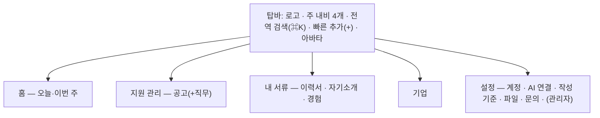

# UI/UX 재설계 계획 (2026-11-04)

> 상태: **계획**(2026-11-04 코드 대조 검토 반영: `/plugin` 공개 유지, `/` 의미 변경, 인라인 저장 덮어쓰기, 되돌리기 제외, 홈 백엔드 필요, 미저장 보호 R1 으로). 근거는 [서비스 이용 흐름](../../service-user-flows.md)과 [디자인 시스템](../../design-system.md). 구현 전에 아래 "결정 필요" 를 닫고, 단계마다 설계 문서(`docs/02-design/features/ui-ux-redesign.design.md`)를 쓴다.

## 1. 목적

지금 화면은 **"목록은 핵심만, 나머지는 클릭해서 본다"**(design-system 목적)를 따른 결과, 모든 기능이 같은 무게로 나열되고 자주 쓰는 동작이 숨어 있다. 사용 빈도와 중요도에 따라 **접근 레이어를 다시 나누고**, 자주 하는 일은 한 번에 보이고 한 번에 끝나게 한다.

## 2. 지금 화면의 문제 (흐름 정리에서 확인한 것)

| # | 문제 | 근거 |
|---|---|---|
| D1 | **상단 탭 6개가 같은 무게.** 매일 쓰는 지원 관리와 가끔 쓰는 기업 조사가 나란히 있다 | 탑바 세그먼트(design-system 규칙 1) |
| D2 | **홈이 칸반뿐.** "오늘 마감·내일 면접·결과 미기록·재검토 필요"를 한눈에 볼 곳이 없다 | `/` = PostingBoard |
| D3 | **숨은 조작.** 수정 진입·화면 이동이 더블클릭/Enter, 상태 변경이 드래그 위주. 처음 쓰는 사람은 발견하기 어렵다 | 규칙 4·5 |
| D4 | **값 수정이 무겁다.** 한 칸을 고쳐도 드로어 보기 → `수정` → 폼 전체 → 저장. 520px 고정 폭이라 폼이 길고 좁다 | 규칙 4, 함정 "드로어 520px" |
| D5 | **검색·필터가 화면마다 다르거나 없다.** 공고·기업 검색 없음, 직무는 화면 안 필터, 자소서만 서버 검색. 전역 검색 없음 | 화면 조사 |
| D6 | **같은 대상이 두 화면에.** 직무는 공고의 일부인데 별도 탭이고 단독 추가가 안 된다 | `/positions` |
| D7 | **관리성 기능이 업무 화면에 섞임.** 첨부 서랍(이력서 목록), 작성 기준(자소서 상단), 관리자 요청(전 화면 떠 있는 버튼), 플러그인 안내(☰ 메뉴) | 화면 조사 |
| D8 | **서류 3종(이력서·자기소개·경험)의 관계가 안 보인다.** 연결이 이력서 편집기 아래, 자소서 칩, 경험 서랍에 흩어져 있다 | 흐름 6·7·10절 |
| D9 | **이력서 편집기가 긴 한 페이지.** 섹션 9개를 스크롤로만 이동, 상단 탭 이동 시 미저장 변경을 묻지 않고 잃음, 409 자동 복구 없음 | 흐름 18절 |
| D10 | **피드백이 약하다.** 저장 성공·실패가 위쪽 알림 한 줄, 충돌(409) 처리 방식이 화면마다 다름 | 흐름 8절 |
| D11 | 404 없음, 빈 상태 안내가 화면마다 다름 | 흐름 18절 |

## 3. 기능별 빈도·중요도와 배치 레이어

| 레이어 | 위치 | 들어갈 것 |
|---|---|---|
| **L1 상시** | 주 내비·홈·전역 검색·빠른 추가 | 매일 쓰고 놓치면 안 되는 것 |
| **L2 화면 주 동작** | 화면 헤더·카드 위 직접 조작 | 그 화면에 온 이유인 동작 |
| **L3 상세** | 상세 패널·탭 | 가끔 보는 세부, 연결 관리 |
| **L4 설정·메뉴** | 설정 화면, 계정 메뉴 | 드물게 쓰는 관리·환경 |

| 기능 | 빈도 | 중요도 | 지금 | 새 레이어 |
|---|---|---|---|---|
| 오늘 할 일(마감·전형 일정·결과 미기록·재검토 필요) | 매일 | 상 | 없음 | **L1 홈** |
| 공고 상태 변경 | 매일 | 상 | 드래그·서랍 select | **L2 카드에서 바로**(드래그 + 보이는 상태 메뉴) |
| 공고 추가 | 주 | 상 | 헤더 버튼 | **L1 빠른 추가** + L2 |
| 전형 단계 완료 체크 | 주 | 상 | 서랍 안 노드 | **L2 카드에 다음 단계 표시·체크** |
| 공고·기업·서류 찾기 | 매일 | 상 | 화면마다 다름 | **L1 전역 검색**(Ctrl/⌘+K) + L2 화면 필터 |
| 이력서 편집 | 주 | 상 | 전체 페이지 | L2(편집기 개편, 6.4) |
| 자소서 작성·검색 | 주 | 상 | 카드 목록 | L2(목록·편집 2단) |
| 경험 정리·가져오기 | 가끔 | 중 | 경험 탭 | L2 "내 서류" 안 |
| 직무 상세 | 주 | 중 | 별도 탭 | **L3 공고 상세 안 탭**(독립 탭 제거, 직무 찾기는 전역 검색) |
| 기업 조사·뉴스 | 가끔 | 중 | 탭 | L1 내비 끝(낮은 무게) |
| 참고 정보 | 가끔 | 하 | 직무 서랍 스트립 | L3 |
| 제출 기록 확인 | 가끔 | 중 | 공고 서랍 | L3 + 홈 "확인 안 한 제출" |
| 첨부 파일 관리 | 드묾 | 하 | 이력서 목록 서랍 | **L4 설정 > 파일** |
| 작성 기준 | 드묾 | 중 | 자소서 상단 접힘 | **L4 설정 > 작성 기준** (+ 자소서 편집기에 "기준 보기") |
| AI 연결 안내 | 드묾 | 중 | ☰ 메뉴 | **L4 설정 > AI 연결** |
| 닉네임·로그아웃 | 드묾 | 하 | 아바타 메뉴 | L4 계정 메뉴(유지) |
| 관리자 요청·피드백 | 드묾 | 하 | 전 화면 떠 있는 버튼 | **L4 계정 메뉴 > 문의·피드백**(안 읽은 답변은 아바타 배지) |
| 관리자 콘솔 | 드묾(관리자) | 중 | ☰ 메뉴 | L4 설정 > 관리자(ADMIN만) |

## 4. 새 정보 구조

- 주 내비 **4개**(홈 · 지원 관리 · 내 서류 · 기업). 설정은 아바타 메뉴와 `/settings`.
- "내 서류" 는 하위 탭 3개와 **관계 보기**(어떤 이력서가 어떤 경험·자소서를 쓰는지)를 묶는다(D8).
- **전역 검색**: 공고·기업·직무·이력서·자소서·경험을 한 입력으로. 종류별로 묶고 Enter 로 상세. 기존 `?focus=` 로 이동.
  지금 서버 검색(`q`)은 직무·참고 정보·자소서에만 있고 공고·기업은 받아 둔 목록에서 찾는다. `SelfIntroductionBoard` 는 `focus` 를 받지 않으므로 추가한다.
- **빠른 추가(+)**: 공고 · 기업 · 이력서 · 자소서 문항 · 경험.
- **경로 호환**: 지금 경로(`/`, `/positions`, `/companies`, `/resumes`, `/introductions`, `/experiences`, `/plugin`, `/admin`)와 `?focus=` 링크는 계속 열려야 한다(공유·북마크). 새 경로로 바꾸면 옛 경로를 새 위치로 보낸다. 경로 변경은 AGENTS 불변 조건 3(세 곳 동시 갱신)과 로그인 왕복 검증을 따른다.
  - **`/` 는 뜻이 바뀐다.** 지금 공고 상세는 `/?focus=<공고id>` 이고 직무·기업 화면이 이 주소로 공고를 연다(`App.vue` `open-posting`). 홈이 대시보드가 되면 `/?focus=` 는 지원 관리로 보낸다.
  - **`/plugin` 은 공개 페이지로 남긴다.** 로그인 검사 전에 그려지는 연결 안내이고 MCP 지침이 이 경로를 가리킨다. 설정 > AI 연결은 이 페이지로 가는 링크다.
  - **관리자 화면을 옮기면 nginx `auth_request` 게이트도 새 경로에 건다**(지금은 `location = /admin` 에만 있다). 데이터 보호는 `/api/admin/**` 가 맡지만 지금 있는 한 겹을 잃지 않는다.
  - 라우터 라이브러리가 없다(`App.vue` 가 pathname 분기, 모르는 경로는 마지막 `v-else` 인 공고 화면). 이동·404·미저장 보호는 `navigate()` 와 `popstate` 두 입구에서 처리한다.

## 5. 공통 상호작용 원칙

1. **보이는 조작이 기본, 제스처는 지름길.** 더블클릭·드래그는 남기되 같은 일을 하는 버튼·메뉴를 항상 둔다(D3).
2. **한 칸 고치기는 그 자리에서.** 상태·마감일·전형 결과·태그·짧은 텍스트는 상세에서 바로 편집(Enter 저장/Esc 취소). 긴 폼 전환은 여러 칸을 고칠 때만(D4).
   **동시 수정 주의**: 공고·기업·직무 수정은 `expectedVersion` 없는 전체 교체 PUT 이다. 화면이 들고 있던 옛 값으로 한 칸을 저장하면 그 사이 AI(MCP)나 다른 탭이 고친 칸을 조용히 덮는다. 상태·전형 결과는 전용 엔드포인트(`/status`, `/steps/{seq}`)라 안전하다. 그 밖의 칸을 인라인 저장하려면 버전 검사를 더하거나(백엔드 변경), 최소한 저장 직전 다시 조회해 바뀐 칸이 있으면 묻는다.
3. **상세는 넓게.** 520px 고정 드로어 → **분할 보기**(목록 + 상세, 폭 조절). 좁은 화면은 전체 화면 상세.
4. **같은 검색·필터 막대.** 화면마다 [검색 · 필터 칩 · 정렬 · 보기 전환]을 같은 자리·같은 모양으로(D5).
5. **저장 피드백 통일.** 성공은 토스트(되돌릴 수 있으면 "되돌리기"), 실패·충돌은 그 자리에. 409 는 전 화면 같은 안내: "다른 곳에서 바뀌었습니다 — 최신 보기 / 내 입력 복사"(D10).
   되돌리기 **제외**: 삭제(연결까지 지우는 영구 삭제라 `ConfirmDialog` 유지), "제출 완료"로의 상태 변경(제출 기록 LINKED 가 남아 상태만 되돌리면 기록과 어긋난다).
6. **미저장 변경 보호는 전역.** 어떤 이동이든 미저장 변경이 있으면 묻는다(D9). `navigate()` 한 곳 + `popstate`(뒤로 가기) + `beforeunload` 로 막는다. 지금 데이터를 잃는 결함이라 R1 에서 먼저 넣는다.
7. **빈 상태는 다음 행동을 알려 준다**, 404 화면을 둔다(D11).
8. **키보드·접근성.** 모든 동작 Tab 도달, 포커스 표시, 단축키(⌘K 검색, N 새로 만들기, ? 도움말 — 한 글자 단축키는 입력칸 안에서 꺼지고 설정에서 끌 수 있게, WCAG 2.1.4), 색만으로 상태를 구분하지 않기, 터치 대상 44px.

## 6. 화면별 방향

- **6.1 홈(신규)**: 마감 D-7 안 관심·작성 중, 다가오는 전형 일정, 결과 미기록 전형, 확인 안 한 제출, 재검토 필요 서류, AI 기록 검토 대기. 항목마다 바로 하는 버튼. 마감·전형 일정·결과 미기록은 [MCP Events E0 `ApplicationAlarms`](../../mcp-events.md) 와 **같은 계산**을 쓴다(웹·AI 가 같은 할 일을 본다). E0 는 아직 설계뿐이고 범위가 공고·전형뿐이라, 확인 안 한 제출·재검토 필요·AI 기록 검토는 홈 집계에서 따로 더한다. 이력서 목록 응답(`ResumeSummary`)에 `needsReview` 가 없어 지금 API 로는 이력서마다 조회해야 한다 → 홈 집계 엔드포인트가 필요하다.
- **6.2 지원 관리**: 칸반 / 표 보기 전환, 표는 정렬·필터(상태·마감·기업·고용형태). 카드: 기업 · 모집 부문 · D-day · **다음 전형 단계** · 상태 메뉴. 상세(분할): 개요 · 전형 · **직무 탭**(직무 화면 흡수, 단독 추가 허용) · 제출 기록 · 메모.
- **6.3 기업**: 검색·업종 필터·"진행 중 공고 있음" 필터. 상세: 개요 · 공고 · 뉴스/유튜브.
- **6.4 이력서 편집기**: 왼쪽 **섹션 목차**(앵커 이동, 행 수·재검토 필요·미연결 표시), 섹션 접기, 아래 고정 **저장 막대**(변경 수·저장·되돌리기), 지원 직무·첨부·자소서 연결은 오른쪽 보조 패널. 409 는 "최신 보기 / 내 변경 다시 적용".
- **6.5 자기소개**: 왼쪽 목록(필터: 문항 유형·지원 직무·출처 미상·AI 기록) + 오른쪽 편집기, 글자 수, "작성 기준 보기"·"쓴 경험" 패널.
- **6.6 경험**: 목록(필터: 종류·AI 기록·재검토 필요) + 상세, 가져오기는 **단계형 마법사**, 상세에 "쓰는 곳"(이력서 행·자소서) 표.
- **6.7 설정(신규 `/settings`)**: 계정 · AI 연결(공개 `/plugin` 으로 가는 링크·연결 상태) · 작성 기준 · 파일(지금 첨부 서랍) · 문의·피드백(지금 요청 위젯) · 관리자(ADMIN, 지금 `/admin`).

## 7. 디자인 시스템 개정 (되돌릴 기존 규칙)

| 지금 규칙(design-system.md) | 바꿀 방향 | 이유 |
|---|---|---|
| 1 탑바 세그먼트 6개 | 주 내비 4개 + 설정 | D1 |
| 2 얇은 헤더 + 카드/칸반만 | 공통 헤더(제목 · 검색/필터 막대 · 주 동작) | D5 |
| 3 카드는 핵심만 | 유지하되 "다음 행동"(다음 전형·상태 메뉴)은 카드에 | D2·D3 |
| 4 상세·수정은 520px 드로어 | 분할 보기 + 인라인 편집 | D4 |
| 5 종속 데이터는 더블클릭 | 보이는 링크/버튼 + 더블클릭 지름길 | D3 |
| 9 관리자 요청 우측 하단 고정 버튼 | 계정 메뉴·설정으로 | D7 |

색·라운드 토큰은 유지하고 타이포 스케일·간격·밀도 토큰, 아이콘 세트, 토스트·분할 패널·인라인 편집·필터 막대·명령 팔레트 컴포넌트를 더한다. 되돌리는 규칙은 `docs/decisions.md` 에 이유를 적는다.

## 8. 단계

| 단계 | 내용 | 끝 조건 |
|---|---|---|
| R0 진단 | 9절 과업 8개를 지금 화면에서 EGO 로 돌려 클릭 수·이동 수·소요 시간을 잰다. 화면 캡처. 과업이 모두 쓰기라 **로컬(8089/8088) 시드 계정**에서만 한다(운영은 읽기 전용) | 전후 비교 기준표 |
| R1 접근 레이어 이동 | 설정 화면 신설, 첨부·작성 기준·AI 연결·문의·관리자 이동, 주 내비 4개, 옛 경로 이동(`/?focus=` 포함), 404, **전역 미저장 보호**(5절 6), 관리자 새 경로 nginx 게이트 | 옛 링크 전부 열림, 로그인 왕복, smoke PASS |
| R2 공통 컴포넌트 | 화면 헤더·필터 막대·토스트·인라인 편집·분할 패널·409 공통 처리·명령 팔레트 | 컴포넌트 테스트, 접근성 점검 |
| R3 지원 관리 | 칸반/표, 카드 상태 메뉴·다음 전형, 상세 분할·직무 흡수 | 과업 1~3 개선 |
| R4 홈 | 오늘·이번 주 할 일. **백엔드 포함**: E0 `ApplicationAlarms` 구현 + 웹 홈 집계 엔드포인트(제출·재검토·AI 검토 수 포함) | 과업 4 |
| R5 내 서류 | 이력서 목차·저장 막대, 자소서 2단, 경험 목록·마법사·관계 보기 | 과업 5~7 |
| R6 기업·마감 | 기업 필터·탭, 빈 상태, 반응형·키보드 최종 점검 | 과업 8, 전 화면 점검표 |

단계마다 별도 PR. 화면만 바꾸고 **백엔드 API 는 원칙적으로 그대로**. 예외로 알려진 것: R4 홈 집계(위), 인라인 저장을 넓히면 공고·기업·직무 버전 검사(5절 2), 공고·기업이 많아지면 서버 검색 `q`. 모든 단계: `npm run type-check && npm test`, smoke PASS, EGO 로 과업 재측정.

## 9. 검증 과업 (전후 같은 과업)

1. 새 공고를 기업과 함께 등록하고 직무 2개·전형 3단계를 넣는다.
2. 공고 하나를 "제출 완료"로 옮기고 실제로 낸 이력서를 확인 기록한다.
3. 1차 면접 단계를 완료로 체크한다.
4. 이번 주 마감 공고와 내일 일정을 찾는다.
5. 이력서의 프로젝트 행 하나를 경험에서 불러오고 저장한다.
6. 협업 문항 자소서를 새로 쓰고 이력서·지원 직무·쓴 경험을 연결한다.
7. 재검토 필요가 뜬 이력서 행을 찾아 원본으로 갱신한다.
8. 특정 기업의 뉴스 링크를 추가하고 그 기업의 진행 중 공고를 연다.

측정: 클릭 수, 화면 이동 수, 소요 시간, 막힌 지점. 측정은 R0 에서 한다(지금은 미측정).

## 10. 지킬 것

- 계정 격리·경로·URL 불변 조건(AGENTS 1·3·4) 그대로.
- 데이터 의미를 바꾸지 않는다: `expectedVersion` 충돌 규칙 유지, AI 기록 확정은 웹 전용, 저장 방식은 결정 필요 2.
- 기능 삭제 없음 — 위치만 옮긴다. 옮긴 기능은 옛 자리에 "여기로 옮겼습니다" 안내를 한 단계 동안 둔다.

## 11. 결정 필요 (설계 전에)

1. **주 내비**: 안 A(홈·지원 관리·내 서류·기업 + 설정, 권장) / 안 B(지금 6개 유지 + 홈·설정 추가).
2. **저장 방식**: 명시 저장 유지 / 짧은 칸은 인라인 즉시 저장 + 긴 폼은 명시 저장(권장) / 자동 저장. 인라인 즉시 저장을 고르면 공고·기업·직무의 덮어쓰기 대책(5절 2: 버전 검사 추가 또는 저장 직전 재조회)도 함께 고른다.
3. **상세 보기**: 분할 보기(권장) / 넓힌 드로어 / 전체 페이지.
4. **직무 탭**: 공고 상세로 흡수(권장) / 유지.
5. **디자인 톤**: 지금 Vibe 라이트 톤·토큰 유지(권장) / 새 비주얼.
6. **주 사용 환경**: 데스크톱 우선(권장) / 모바일 동등.
7. **시안 방식**: Figma 시안 먼저 / 코드 프로토타입(EGO 로 바로 측정) 먼저.
