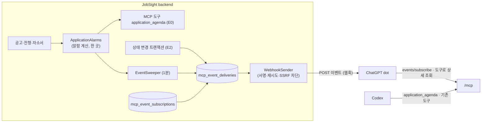

# MCP Events — 지원 관리 알람 (설계, 미구현)

> 상태: **설계, 미구현** (2026-11-03). 근거로 삼는 MCP Events 는 정식 표준이 아니라 초안 확장(SEP-3415, Triggers & Events 작업 그룹)이다. 세부(오류 코드 번호 등)가 바뀔 수 있으므로 프로토콜에 닿는 코드는 한 패키지에 가둔다(불변 조건 6).

## 목적

MCP 에 연결된 에이전트가 **사용자가 대화를 열지 않아도** 먼저 알려 주게 한다. 예: ChatGPT 의 dot 이 "○○ 공고 마감이 3일 남았어요", "내일 14시 △△ 1차 면접이에요" 라고 말을 건다.

- **ChatGPT(dot·업무 채팅)**: 이벤트를 받아 먼저 알려 주는 쪽. OpenAI 문서가 MCP Events 웹훅 전달을 지원한다고 밝힌다.
- **Codex**: 이벤트 수신 지원이 문서에 없다. 지원 관리를 함께 하는 작업 도구(기존 MCP 도구 + E0 의 `application_agenda`)로 쓴다.



## 단계

| 단계 | 내용 | 끝 조건 |
|---|---|---|
| E0 | 알람 계산 `ApplicationAlarms` + MCP 도구 `application_agenda` | 계산 규칙 표의 모든 줄이 고정 시계 단위 테스트로 있다. Codex 에서 호출 확인 |
| E1 | `events/list`·`subscribe`·`unsubscribe`, 주소 검증, 시간 기반 이벤트 3종 웹훅 발송 | 가짜 수신기 통합 테스트 + 공개 주소(`job.donyk.link`)에서 ChatGPT 구독 1회 실제 수신 |
| E2 | 변경 기반 이벤트(`application.status_changed`, `self_intro.needs_review`) | 같은 트랜잭션 기록(outbox)·롤백 시 미발송 테스트 |

## 이벤트 카탈로그

모든 시간은 `Asia/Seoul` 기준으로 계산한다(`AdminRequestService.QUOTA_ZONE` 과 같은 상수를 공용으로 옮긴다). 사용자별 시간대는 두지 않는다(열린 질문).

| 이벤트 `name` | 언제 | 대상 | 구독 인자(`inputSchema`) | 단계 |
|---|---|---|---|---|
| `application.deadline_approaching` | 마감일 n일 전 09:00 | 상태 `INTERESTED`·`DRAFTING`, 보관 안 됨, `deadlineAt` 있음 | `offsetsDays: int[]` 기본 `[7,3,1]`, 각 0~30, 최대 5개(0 = 마감 당일 09:00) | E1 |
| `application.step_upcoming` | 전형 일정 전날 09:00, 당일 `hoursBefore` 시간 전 | 결과 `UPCOMING`, `scheduledAt` 있음, 보관 안 된 공고 | `hoursBefore: int` 기본 2, 1~24 | E1 |
| `application.step_result_pending` | 일정 `graceDays` 일 뒤 09:00 에 아직 `UPCOMING` | 같은 대상 | `graceDays: int` 기본 3, 1~14 | E1 |
| `application.status_changed` | 공고 상태가 바뀐 트랜잭션 커밋 | 모든 상태 변경(웹·MCP·자동 보관) | 없음 | E2 |
| `self_intro.needs_review` | 경험 CORRECT 로 자소서 근거에 재검토가 생김 | 그 자소서 | 없음 | E2 |

전형 결과는 지금 `UPCOMING`·`PASSED` 두 값뿐이다(`StepResult`). "결과 미기록"은 일정이 지났는데 `UPCOMING` 인 상태를 뜻한다.

**이벤트 키(멱등).** `event_key = 이벤트이름 + 대상 id + 기준 시각 + 오프셋`. 예: `deadline:{postingId}:{deadlineAt epoch}:3`. 마감일을 고치면 키가 바뀌어 새 알람이 생기고, 옛 키의 아직 안 보낸 행은 발송 직전 재확인(아래)에서 버린다. 같은 키는 구독마다 한 번만 보낸다(`UNIQUE (subscription_id, event_key)`).

**발송 직전 재확인.** 큐에 있던 알람도 보내기 직전에 원본을 다시 읽어 여전히 맞는지 본다(상태가 바뀌었거나 보관됐거나 결과를 기록했으면 `SKIPPED`). 알람은 "그때 맞았던 것"이 아니라 "지금도 맞는 것"만 보낸다.

**밀린 알람(컨테이너가 꺼져 있던 동안).** 예정 시각이 지났어도 아직 의미가 있으면(마감·일정이 아직 미래) 한 번 보내고 `data.late: true` 를 단다. 의미가 없어졌으면(마감이 이미 지남) 보내지 않는다. 오프셋 여러 개가 함께 밀렸으면 **가장 가까운 것 하나만** 보낸다(D-7·D-3 이 동시에 밀리면 D-3 만).

**본문(`data`) — 최소한만.** 요약과 id 만 싣는다. 메모·자소서 답변·경험 사실은 싣지 않는다. 자세한 내용은 에이전트가 기존 도구(`posting_get` 등)로 읽는다.

```json
{
  "eventId": "evt_01JC0000000000000000000000",
  "name": "application.deadline_approaching",
  "timestamp": "2026-11-10T00:00:00Z",
  "data": {
    "postingId": "22222222-2222-4222-8222-222222222222",
    "companyName": "예시 IT 서비스 기업",
    "postingTitle": "AX 개발자 신입 공채",
    "status": "DRAFTING",
    "deadlineAt": "2026-11-13T14:59:00Z",
    "daysLeft": 3,
    "late": false,
    "webUrl": "https://job.donyk.link/?focus=22222222-2222-4222-8222-222222222222"
  },
  "cursor": "1042"
}
```

- `webUrl` 은 `PUBLIC_BASE_URL` + `routes.ts` 경로로만 만든다(AGENTS 불변 조건 4 — 요청 헤더로 URL 을 조립하지 않는다). 공고 화면은 `ROUTES.home`(`/`)이고 `FOCUS_QUERY`(`focus`)를 붙인다. 지금 `focus` 로 열리는 것이 확인된 화면은 직무 등(`/positions?focus=`)이라, 공고 화면이 `focus` 를 받는지는 E1 구현 때 확인하고 없으면 함께 만든다.
- 회사명·공고 제목은 사용자가 입력한 문자열이다. 수신 측에는 **데이터**로 넘기고 지시문을 넣지 않는다(초안 권고와 같음).

## 프로토콜 계약 (초안 기준 — `mcp/events` 패키지에 가둔다)

**기능 알림.** `app.mcp.events.enabled=true` 일 때만 `initialize` 의 `capabilities` 에 `"events": {}` 를 더한다. 꺼져 있으면 `events/*` 는 `-32601 Method not found`. 웹훅 방식이라 지금의 무상태 JSON 응답 구조(`McpController`, `GET /mcp` 405)는 바꾸지 않는다 — SSE·세션이 필요 없다.

**`events/list`** → `{events:[{name, description, delivery:["webhook"], inputSchema, payloadSchema}], nextCursor?}`. 위 카탈로그 중 활성 단계 이벤트만.

**`events/subscribe`** params `{name, arguments, delivery:{mode:"webhook", url, secret}, cursor?, ttlMs?}`

1. 권한: `jobsight.read` 스코프 필수(이벤트가 데이터를 내보낸다). 계정이 `ACTIVE` 가 아니면 거절.
2. 검증: `name` 이 목록에 있음, `arguments` 가 `inputSchema` 를 만족(범위 밖은 `-32602 InvalidParams`, 조용히 자르지 않음), `secret` 은 `whsec_` + base64 로 24~64 바이트, `url` 은 아래 "외부 전송 안전" 통과.
3. **주소 검증 절차**: 처음 보는 (계정, url) 이면 `{"type":"verification","challenge":"<1회용>"}` 를 서명해 POST 하고, 2xx 와 `{"challenge":...}` 일치를 상수 시간 비교로 확인한다. 실패하면 `CallbackEndpointError`(`data.reason`: `challenge_failed`·`timeout`·`blocked_address`). 성공은 (계정, url) 단위로 기억한다.
4. 구독 id 는 결정적이다: `SHA-256(owner, oauthClientId, name, 정규화 JSON arguments, url)`. 같은 요청을 다시 보내면 같은 구독이 갱신된다(멱등, 비밀값 교체 포함).
5. 만료: `ttlMs` 생략 → 24시간, 최대 7일. `ttlMs: null`(무기한)은 주지 않고 기본값으로 응답한다. 응답 `{id, refreshBefore(= 만료 1시간 전), cursor, truncated:false}`. 만료가 지나면 발송을 멈춘다(호스트가 `refreshBefore` 전에 다시 subscribe 해 연장).
6. `cursor`: 이 구독의 발송 순번(`mcp_event_deliveries.seq`). 주면 그 뒤 미발송분을 보내 준다(최대 50건, 넘으면 `truncated:true`).

**`events/unsubscribe`** params `{name, arguments, delivery:{mode, url}}` → `{}`. 멱등이고 소유자 범위에서만 지운다(남의 것은 없는 것과 같다).

**전달(웹훅).**
- `POST`, `Content-Type: application/json`, 이벤트 하나에 요청 하나, 본문 ≤ 256 KiB(우리 본문은 1 KiB 안팎).
- 헤더: `webhook-id`(= `eventId`), `webhook-timestamp`(Unix 초), `webhook-signature`, `X-MCP-Subscription-Id`.
- 서명: Standard Webhooks — `v1,` + base64(HMAC-SHA256(비밀값 바이트, `webhook-id + "." + webhook-timestamp + "." + 본문 바이트`)). 비밀값 교체 직후 짧은 기간은 옛·새 키 서명 둘을 공백으로 이어 보낸다.
- 재시도: 1·2·4·8분(4회), 재시도마다 `eventId` 는 같고 시각·서명은 새로. `410` 이면 구독 삭제, `413` 이면 그 이벤트 폐기, 그 밖의 4xx/5xx·연결 실패는 재시도. 연속 실패 20회면 구독을 `SUSPENDED`(다시 subscribe 하면 풀림).
- 순서는 보장하지 않는다. 수신 측이 `eventId` 로 중복을 거른다.

**오류 코드.** 초안 문서끼리 번호가 다르다(OpenAI 문서 `-32015`, 설계 초안 `-32027`). OpenAI 문서 값을 쓰고 `McpEventErrors` 상수 한 곳에 둔다. 표준이 확정되면 그 한 곳만 고친다.

## 저장 구조 (E1 마이그레이션 스케치)

```sql
CREATE TABLE mcp_event_subscriptions (
    id               VARCHAR(64)  PRIMARY KEY,           -- 결정적 id (SHA-256 hex)
    owner_id         UUID         NOT NULL REFERENCES app_users (id) ON DELETE CASCADE,
    oauth_client_id  VARCHAR(200) NOT NULL,
    name             VARCHAR(100) NOT NULL,
    arguments        JSONB        NOT NULL,              -- 정규화 JSON
    delivery_url     VARCHAR(2000) NOT NULL,
    secret_enc       BYTEA        NOT NULL,              -- AES-GCM, 키는 .secrets/mcp_events_key
    status           VARCHAR(10)  NOT NULL CHECK (status IN ('ACTIVE','SUSPENDED')),
    expires_at       TIMESTAMPTZ  NOT NULL,
    consecutive_failures INT      NOT NULL DEFAULT 0,
    created_at       TIMESTAMPTZ  NOT NULL,
    updated_at       TIMESTAMPTZ  NOT NULL
);
CREATE INDEX mcp_event_subscriptions_owner_idx ON mcp_event_subscriptions (owner_id, name) WHERE status = 'ACTIVE';

CREATE TABLE mcp_event_deliveries (                       -- 알람 큐이자 발송 기록(outbox)
    seq              BIGINT       GENERATED ALWAYS AS IDENTITY PRIMARY KEY,  -- cursor
    subscription_id  VARCHAR(64)  NOT NULL REFERENCES mcp_event_subscriptions (id) ON DELETE CASCADE,
    owner_id         UUID         NOT NULL,
    event_id         VARCHAR(40)  NOT NULL,
    event_key        VARCHAR(300) NOT NULL,
    name             VARCHAR(100) NOT NULL,
    data             JSONB        NOT NULL,
    due_at           TIMESTAMPTZ  NOT NULL,
    status           VARCHAR(10)  NOT NULL CHECK (status IN ('PENDING','SENT','SKIPPED','FAILED')),
    attempts         INT          NOT NULL DEFAULT 0,
    next_attempt_at  TIMESTAMPTZ,
    UNIQUE (subscription_id, event_key)
);
CREATE INDEX mcp_event_deliveries_due_idx ON mcp_event_deliveries (next_attempt_at) WHERE status = 'PENDING';
```

- 보존: `SENT`·`SKIPPED`·`FAILED` 행은 30일 뒤 스위퍼가 지운다.
- 계정 삭제 → 구독 → 발송 행이 CASCADE 로 사라진다.

## 생성과 발송 — `EventSweeper`

`@Scheduled(fixedDelay = 60s)` 하나. 회차마다:

1. **시간 기반 알람 채우기**: 활성 구독마다 앞으로 25시간 안에 울릴 알람을 `ApplicationAlarms` 로 계산해 `INSERT … ON CONFLICT (subscription_id, event_key) DO NOTHING`. 25시간 창이라 하루 넘게 꺼져 있다 켜져도 "밀린 알람" 규칙으로 따라잡는다.
2. **발송**: `status = 'PENDING' AND next_attempt_at <= now()` 를 `FOR UPDATE SKIP LOCKED` 로 32개 집어, 발송 직전 재확인 → 트랜잭션 밖에서 HTTP → 짧은 트랜잭션으로 결과 기록. 임베딩 스위퍼와 같은 모양(행마다 짧은 트랜잭션, 외부 호출은 트랜잭션 밖).
3. 30일 지난 기록 정리.

- 소유자 조건 없는 조회(모든 계정의 활성 구독)는 `mcp/events` 패키지의 패키지 전용 저장소 하나에만 둔다 — 임베딩 스위퍼의 D13 예외와 같은 방식.
- **결정 재검토가 필요하다**: `docs/decisions.md` 「마감된 "관심" 공고 자동 보관은 조회 시점에 (스케줄러 없음)」·「임베딩 스위퍼만 `@Scheduled` 와 소유자 조건 없는 조회를 쓴다」. 알람은 "사용자가 보지 않을 때" 울려야 해서 조회 시점 처리로는 불가능하다. 옛 결정의 이유였던 "꺼진 기간을 건너뜀"은 25시간 창과 밀린 알람 규칙으로 메운다. 구현 PR 에서 decisions.md 에 되돌림 이유를 적는다.
- E2 변경 기반 이벤트는 스위퍼가 아니라 **그 변경 트랜잭션 안에서** 활성 구독마다 발송 행을 넣는다(outbox). 롤백되면 알람도 없다. 발송은 같은 스위퍼가 한다.

## 외부 전송 안전 (SSRF·비밀값)

서버가 **남이 준 URL 로 요청을 보낸다.** 이 서버는 집 네트워크 안에서 돈다 — 내부망으로 새는 것을 가장 경계한다.

- `https` 만, 포트 443 만, 리디렉션 따르지 않음, 사용자 정보(`user@`)가 들어간 URL 거절.
- 호스트 이름을 직접 해석해 **모든 주소**가 공인 주소일 때만 허용한다. 거절: 루프백, 사설(10/8, 172.16/12, 192.168/16), 링크 로컬(169.254/16, fe80::/10), CGNAT(100.64/10), 0/8, 멀티캐스트, IPv6 ULA(fc00::/7), IPv4-mapped IPv6 의 위 대역.
- **해석한 IP 로 그대로 연결**한다(검사와 연결 사이에 DNS 가 바뀌는 rebinding 차단). TLS 는 원래 호스트 이름으로 검증(SNI).
- 연결 3초·전체 10초 제한, 응답 본문은 최대 4 KiB 만 읽는다.
- 테스트에서만 사설 주소를 허용하는 설정(`app.mcp.events.allow-private-targets`)을 두되 `application.yml` 기본값은 `false` 이고 운영 compose 에서 켜지 않는다.
- 구독 비밀값은 서명에 원문이 필요하므로 해시가 아니라 **암호화**해 둔다. 키는 `.secrets/mcp_events_key`(32바이트) → compose secret → `configtree`(AGENTS 불변 조건 2). 비밀값·서명·본문은 로그에 남기지 않는다(로그는 `subscription= event= status= ms=` 만).
- 발송 때마다 계정이 `ACTIVE` 인지, 그 OAuth 클라이언트에 대한 사용자 동의가 남아 있는지 확인하고, 아니면 구독을 지운다.
- 새 비밀 파일과 설정이 생기므로 구현 PR 은 `.env.example`·`compose.yaml`·`docs/local-dev.md`·`docs/nginx-deploy.md` 를 함께 갱신한다(AGENTS 「건드린 것 → 반드시 돌릴 것」).

## E0: `application_agenda` (Codex·ChatGPT 공통)

`application_agenda({days?: 1~60 기본 14})` → 같은 `ApplicationAlarms` 로 `{items:[{kind, postingId, companyName, postingTitle, at, daysLeft, stepName?}], overdue:[결과 미기록·마감 지난 작성 중]}`. 읽기 전용, `jobsight.read`. 이벤트를 받지 못하는 클라이언트(Codex)가 "이번 주 할 일"을 묻는 길이자, 알람 계산 규칙을 이벤트보다 먼저 검증하는 단계다. 조회만 하므로 스케줄러 결정과 무관하게 먼저 낼 수 있다.

## 불변 조건

1. 이벤트는 구독한 계정 자기 자료만 담는다. 발송 직전 재확인과 계정 상태 확인을 건너뛰지 않는다.
2. 외부 URL 로의 모든 요청은 `WebhookSender` 한 곳을 지난다(SSRF 검사 우회 금지).
3. 비밀값은 암호화 저장, 로그 금지. 키는 `.secrets` 로만.
4. 웹 링크는 `PUBLIC_BASE_URL` + `routes.ts` 경로로만 만든다.
5. 이벤트 본문에 메모·자소서·경험 원문을 넣지 않는다.
6. MCP Events 초안에 닿는 이름·오류 코드·서명 형식은 `mcp/events` 패키지 안에만 둔다.
7. 같은 (구독, 이벤트 키)는 한 번만 `SENT` 가 된다.

## 실행·검증 (구현 때)

```bash
# 단위: ApplicationAlarms(고정 Clock — 오프셋·09:00 KST·밀린 알람·가장 가까운 것 하나·마감 지난 것 제외·전형 결과 미기록),
#       Standard Webhooks 서명(공개 테스트 벡터), SSRF 판정(대역별 표), 구독 id 결정성
# 통합(Testcontainers): subscribe → 검증 절차(가짜 수신기, allow-private-targets=true) → 알람 채우기 → 발송·서명 검증,
#       재시도·410·413·연속 실패 정지, 발송 직전 재확인(SKIPPED), 계정 비활성·동의 철회 시 삭제, 소유자 격리, cursor 재전송
bash scripts/smoke.sh                              # PASS
```

실제 수신(ChatGPT dot)은 공개 HTTPS 주소에서만 확인할 수 있다 — 로컬 `127.0.0.1:8088/8089` 로는 ChatGPT 가 붙지 못한다. E1 끝 조건의 실제 수신은 `job.donyk.link` 배포 뒤에 한다.

## 함정

- **초안이다.** 메서드 이름·필드·오류 번호가 확정 전이다. 문서끼리 오류 번호가 다른 것을 이미 확인했다(`-32015` vs `-32027`).
- **Codex 는 이벤트 수신이 문서에 없다.** Codex 용은 `application_agenda` 다.
- **ChatGPT 는 폴링·스트리밍 전달과 `gap`·`terminated` 제어 알림을 지원하지 않는다**(OpenAI 문서). 웹훅만 구현한다.
- 이벤트 시각(09:00 KST)은 서버 시계 기준이다. 컨테이너 시계가 틀리면 알람도 틀린다 — `timestamp` 는 UTC 로 싣고 계산만 KST 로 한다.
- 2026-07-28 MCP 릴리스 후보는 서버가 시작하는 요청을 "클라이언트 요청 처리 중"으로 제한했다(SEP-2260). 웹훅은 MCP 연결 밖이라 해당하지 않지만, 지원 프로토콜 버전을 올릴 때 다시 본다.

## 열린 질문

- 기본 오프셋(`[7,3,1]`, 전형 2시간 전, 결과 미기록 3일)과 알림 금지 시간대(예: 22:00~08:00)를 둘지.
- 사용자별 시간대가 필요한지(지금은 KST 고정).
- 이벤트 본문에 회사명·공고 제목을 넣을지, id 만 넣고 에이전트가 읽게 할지(제3자 전송 범위 — 지금 안은 넣는다).
- 결과 미기록 알람의 대상에서 "서류 제출 단계"처럼 결과 발표가 늦은 단계를 뺄지.

## 근거

- OpenAI, [MCP Events](https://developers.openai.com/plugins/build/mcp-events.md) — ChatGPT(dot 포함) 웹훅 전달 지원, 구독·검증·서명·재시도 규칙.
- MCP 작업 그룹, [Triggers & Events 설계 초안](https://github.com/modelcontextprotocol/experimental-ext-triggers-events/blob/main/docs/design-sketch-proposal.md) · [작업 그룹](https://modelcontextprotocol.io/community/working-groups/triggers-events).
- 현재 서버 구조: `McpController`(무상태 JSON 응답, `GET /mcp` 405), `McpOAuthConfig.SCOPES`, `StepResult`, docs/mcp-plugin.md.
