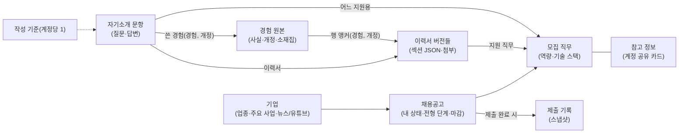

# JobSight 서비스 이용 흐름 (2026-11-04, `main` 23a570a 기준)

> 코드·마이그레이션(V1~V29)·도메인 문서를 대조해 정리한 **사용자 관점 안내서**다. 개발 규칙은 각 영역 문서(docs/job-postings.md 등)가 정본이다.
> 표기: 〔웹〕 웹 화면에서만 가능 · 〔AI〕 MCP 도구로만 가능 · 〔둘 다〕.

## 0. 한눈에 보기

JobSight 는 **한 사람의 취업 준비 자료를 한 곳에 모으는** 서비스다. 계정마다 자료가 완전히 분리되고(남의 자료는 404), 웹과 AI(ChatGPT·Codex·Claude Code, MCP)가 같은 자료를 다룬다.

**추천 사용 순서**: ① Google 로그인(승인) → ② 기업 등록 → ③ 채용공고 등록(직무·전형 포함) → ④ 이력서 작성(지원 직무 연결) → ⑤ 경험 원본 만들기(이력서에서 가져오기) → ⑥ 자기소개 문항 작성(이력서·지원 직무·쓴 경험 연결) → ⑦ 칸반에서 상태 이동(제출 완료 시 제출 기록 자동 생성) → ⑧ 실제로 낸 것 확인 → ⑨ AI 연결로 공고 맞춤 경험 찾기·자소서 초안.

---

## 1. 계정 — 가입·로그인·세션

| 단계 | 동작 |
|---|---|
| 로그인 화면 | 로그인 안 된 모든 경로에서 `LoginView`. "Google로 계속하기" 하나뿐(비밀번호 로그인 없음). Google 설정이 없으면 "미설정" 안내 |
| 첫 로그인 | Google 계정으로 가입. **자동 승인**이 켜져 있으면 바로 `ACTIVE`, 꺼져 있으면(기본) `PENDING` → "가입 신청이 접수되었습니다" 안내 |
| 상태 | `PENDING`(승인 대기)·`REJECTED`(거절)는 로그인 화면에 안내만, `SUSPENDED`(정지)는 오류 안내, `ACTIVE` 만 사용 가능 |
| 기존 계정 연결 | 같은 이메일(검증된 것)의 계정이 있으면 Google 을 그 계정에 연결. 이메일 미검증이면 `EMAIL_NOT_VERIFIED` |
| 관리자 이메일 | `APP_ADMIN_EMAIL` 계정은 로그인할 때마다 ADMIN/ACTIVE 로 복구된다(화면에서 내려도 소용없음) |
| 세션 | 30분 미사용 시 세션 만료. 대신 **로그인 유지 토큰**(30일, 기기마다, 쓸 때마다 교체)으로 자동 갱신 — 화면은 401 을 받으면 한 번 갱신하고 다시 시도 |
| 닉네임 | 아바타 → 메뉴에서 닉네임(최대 80자) 수정·비우기 〔둘 다: `account_update`〕. 이메일은 바꿀 수 없음 |
| 로그아웃 | 아바타 메뉴 → 로그아웃(이 기기의 유지 토큰 삭제) |
| 탈퇴 | **본인 탈퇴 기능 없음.** 관리자만 계정 삭제 가능(모든 자료 연쇄 삭제) |
| 로그인 오류 코드 | `?authError=` → `ACCOUNT_NOT_APPROVED`(접수 안내), `ACCOUNT_SUSPENDED`·`EMAIL_NOT_VERIFIED`·`INVALID_IDENTITY`·`DOMAIN_CHANGED`(오류) |

시작 화면 상태: 세션 확인 중 스피너 → 서버 연결 실패 시 "서비스에 연결할 수 없습니다 / 다시 시도".

## 2. 화면 구조

| 경로 | 화면 | 비고 |
|---|---|---|
| `/` | 채용공고 칸반(홈) | **없는 경로도 여기로**(404 화면 없음) |
| `/positions` | 모집 직무 | 직무는 공고에서만 만든다(단독 추가 버튼 없음) |
| `/companies` | 기업 | |
| `/resumes` | 이력서 목록 | `?focus=<id>` 면 편집기 |
| `/introductions` | 자기소개 + 작성 기준 | |
| `/experiences` | 경험 원본 | |
| `/admin` | 관리자 콘솔 | ADMIN 만 |
| `/plugin` | AI 연결 안내 | 로그인 없이도 열림 |

- 상단 탭: 채용공고 · 모집 직무 · 기업 · 이력서 · 자기소개 · 경험. "☰ 메뉴": 플러그인 연결 가이드, (관리자) 관리자.
- 모든 화면 오른쪽 아래 **"관리자 요청"** 버튼(안 읽은 답변 수 배지).
- `?focus=<id>`: 그 화면이 목록을 읽은 뒤 해당 항목 서랍(드로어)을 연다. 화면 사이 이동은 대부분 **더블클릭/Enter**(예: 공고 안 직무 행 → `/positions?focus=`).
- 공통 동작: 서랍 하나가 보기·수정·추가를 겸함, Esc·바깥 클릭으로 닫힘, 삭제는 항상 확인 대화상자, 상세 빈 곳 더블클릭 = 수정, 메모는 Markdown(제목·목록·들여쓰기(Tab/Shift+Tab)·http(s) 링크).
- 브라우저 뒤로/앞으로 동작.

## 3. 기업 〔둘 다: `company_*`〕

1. **기업 추가**: 이름(필수, 계정 안에서 공백·대소문자 무시 중복 금지), 홈페이지, 소개, 업종 태그(최대 10), 형태(스타트업·중소·중견·대기업·공기업), 설립 연월, 매출(만 원/억 원 선택 — 저장은 원 단위), 사원 수, 주소, **주요 사업**(최대 20, 순서 변경), 복지, 메모.
2. **서랍 → 기업 정보**: 사실 + "채용정보 · 마감 전 N건"(공고 더블클릭 → 칸반).
3. **서랍 → 뉴스·유튜브**: "자료 추가"(종류 뉴스/유튜브, 제목·링크 필수, 출처·미리보기 선택) → 카드에서 링크 열기·수정·삭제. 서버는 링크를 방문하지 않는다(임베드 없음, 새 탭으로 열기).
4. **삭제**: 소속 공고·직무·전형·자료가 **모두** 함께 삭제된다(확인창 경고).

공고를 만들 때 기업 이름만 적으면 기존 기업을 찾고(공백·대소문자 무시), 없으면 이름만 있는 기업을 새로 만든다.

## 4. 채용공고와 칸반 〔둘 다: `posting_*`〕

**4-1. 공고 추가** — 기업(선택 또는 직접 입력), 모집 부문(필수), 공고 링크, 고용형태(정규·계약·인턴·파트·파견), 내 상태, 서류 마감(기본값 지금 시각, **비우면 상시채용**), 직무 목록(비우면 공고 제목으로 직무 1개 생성), 전형 단계(이름·일정, 순서), 지원자격, 메모.

**4-2. 두 가지 진행 축**

| 축 | 값 |
|---|---|
| 내 상태 | 관심 · 작성 중 · 제출 완료 · 필기 준비 · 면접 준비 · 합격 · 서류/필기/면접 탈락 (구 `CLOSED` 는 기존 데이터용) |
| 회사 전형 | 공고마다 단계 사슬(서류 → 인적성 → 면접…). 노드 클릭 = 예정 ↔ 완료, "현재 단계" = 첫 예정 단계 〔AI: `posting_set_step_result`〕 |

**4-3. 칸반 탭** (탭마다 개수 배지, D-day 순, 상시채용은 맨 뒤)

| 탭 | 열 |
|---|---|
| 관심 공고 | 관심 · 작성 중 |
| 진행 중 | 제출 완료 · 필기 준비 · 면접 준비 · 합격 |
| 보관함 | 미지원 · 서류/필기/면접 탈락 · 기타 보관 |

- **드래그 앤 드롭**: 열에 놓으면 그 상태, 탭에 놓으면 탭 기본값(관심 → 관심, 진행 중 → 제출 완료). 보관함 탭에 놓으면 제출 완료 → 서류 탈락, 필기 준비 → 필기 탈락, 면접 준비 → 면접 탈락, 관심·작성 중 → 상태 유지(미지원), 합격 → 기타 보관.
- **자동 보관**: ① 마감이 지났는데 관심·작성 중인 공고(목록을 열 때 처리) ② 탈락 상태로 바꾸면 즉시. 탈락이 아닌 상태로 바꾸면 보관함에서 빠진다(마감 지난 관심·작성 중은 다음 조회 때 다시 보관).
- 수동 보관/되돌리기: 서랍 헤더 버튼 〔AI: `posting_set_archived`〕.
- 카드: D-day 칩(상시, D-DAY, D-n, 마감 +n), 상태, 직무 수.

**4-4. 서랍** — 내 상태 즉시 변경, 전형 노드 토글, 기업 링크, 직무 행(더블클릭 → 직무, "지원" 칩 = 지원 대상 직무), 수정·보관·삭제. 삭제 확인창은 "자소서 N개의 직접 출처(어느 지원용) 연결이 사라진다"를 보여 준다(답변은 남음).

**4-5. 제출 기록** — 12절.

## 5. 모집 직무와 참고 정보 〔둘 다: `position_*`, `reference_*`〕

- 직무는 공고의 일부로만 생긴다. 탭(관심/진행/보관)은 부모 공고를 따른다. 검색창: 이름·기업·공고·팀·기술 스택(화면 안 필터).
- 필드: 이름(필수), 팀, 역할, 인원, 근무지, 기술 스택 태그, 담당업무, 임팩트, 요구 역량, 우대 역량, 성장, 얻는 경험, 메모.
- **마지막 직무를 지우면 공고도 지워진다**(확인창 안내).
- 공고 수정에서 직무 목록을 바꿀 때 id·이름으로 기존 직무를 맞춰 이력서·자소서 연결을 지킨다. 맞지 않는 기존 직무는 삭제된다(이 경로는 자소서 연결 경고가 **없음**).
- **참고 정보**(계정 전체 공유 카드, 종류: 참고 직무·경력 모집·선배 인터뷰·아티클·기타): 직무 서랍에서 "기존에서 검색"으로 붙이기 / "새로 만들기". **떼기** = 이 직무에서만 연결 해제, **삭제** = 모든 직무에서 제거(확인). 참고 직무로 가리킨 직무가 지워지면 카드는 남는다.

## 6. 이력서 〔웹 + AI: `resume_*`〕

**6-1. 목록** — "이력서 추가"는 즉시 "새 이력서"를 만들고 편집기를 연다. 이름은 중복 가능(id 로 구분). 상단 **[첨부 파일]** 서랍(9절).

**6-2. 편집기(전체 화면)**

| 영역 | 내용 |
|---|---|
| 머리 | ← 목록, 이름(필수), "변경됨 · 저장 전" 표시, 내보내기, 복제, 삭제, 저장(변경 있을 때만) |
| 지원 직무 | 검색 콤보박스(↑↓·Enter·Esc), 여러 개, 칩 × 로 해제 — 저장 때 함께 저장 |
| 기본정보 | 이름, 휴대전화, 생년월일, 이메일, 주소, 포트폴리오 URL·파일, GitHub |
| 섹션 | 학력 · 교육이수 · 대내외활동 · 경력 · 수상 · 자격증 · SW 역량 · 프로젝트. 섹션당 최대 50행, "+ 행 추가", 행마다 ↑ ↓ × |
| 학력 | 학교 구분(대학교/고등학교/기타)에 따라 칸과 성적표(학기별 표)가 바뀐다. 숨은 칸 값은 지우지 않음 |
| 증빙 파일 | 포트폴리오·졸업증명·성적증명·이수증·활동 첨부·수상 증빙·자격증 사본 |
| 자기소개 문항 | 이 이력서에 연결된 문항 목록·인라인 수정, "문항 추가", "과거 질문·답변 검색 → 추가", "답변 관리"(→ /introductions) |

- 날짜(연월)는 자유 문자열(예: `2024.03`, `현재 교육 중`).
- 행 편집은 화면 안에서만 바뀌고 **저장을 눌러야** 반영. 저장하지 않고 "← 목록" 하면 확인, 탭 닫기·새로고침은 브라우저 경고. **상단 탭으로 이동할 때는 묻지 않는다.**
- 저장 충돌: 다른 곳(AI 등)이 먼저 저장했으면 409 `RESUME_STALE`(오류 안내만, 자동 새로고침 없음), 동시 저장은 409 `RESUME_BUSY`.
- **복제**: 같은 내용·같은 지원 직무로 "(복사)" 생성. 자소서 문항은 복제하지 않는다. 첨부·경험 연결은 공유된다.
- **내보내기**: PDF(인쇄 대화상자), Word(.doc 다운로드), 고른 첨부를 `-첨부파일.zip` 으로.
- **경험 연결**(프로젝트·경력·대내외활동·교육이수 섹션) — 10-4절.
- 〔AI 전용〕 행 단위 도구 `resume_basic_update`·`resume_row_add/update/delete`, `resume_add_experiences`(경험 원본으로 행 만들기), `resume_get(view=outline)`(목차 + 빠진 경험 `missing`). 웹 저장은 문서 통째 저장.

## 7. 자기소개 〔웹 + AI: `self_intro_*`〕

- `/introductions`: 검색(단어 포함·하이라이트, 비우면 최근 수정순) → 카드(수정·삭제), "문항 추가"(이력서나 직무가 하나라도 있어야 활성).
- 편집기: 연결 이력서(검색), **지원 직무**(어느 지원용, 최대 10 — 없으면 연결 이력서의 직무로 "어느 지원용?" 추천 칩), **문항 유형**(최대 3, 18개 고정 코드 — 지정하지 않으면 정규식 추정 2개를 "추정"으로 표시), **쓴 경험**(최대 10, 고를 때의 개정 번호가 고정), 질문(필수 1000자), 답변(선택 10000자).
- 새 문항은 이력서 또는 직무가 1개 이상 필요. 수정할 때는 0개도 허용(직무가 지워진 경우 등). 직접 출처가 없으면 "출처 미상".
- **AI 기록 확정**: AI 가 단 연결은 "AI 기록" 칩(✓ 확정 = 즉시 저장, ✗ = 초안에서 빼고 저장 때 반영). AI 는 연결을 **더하기만** 하고 지우거나 확정할 수 없다. "확정"은 사용자가 연결을 확인했다는 뜻이지 성과 검증이 아니다.
- 저장 충돌: 409 `SELF_INTRO_STALE` → 목록을 다시 읽고 초안은 유지.
- 18개 문항 유형: 협업·팀워크, 의사소통·설득, 문제 해결, 갈등 조정, 리더십·주도성, 도전·목표 달성, 실패와 극복, 학습·자기개발, 기술 전문성, 데이터·수리 분석, 개선·창의, 고객·사용자 지향, 원칙·직업윤리, 지원동기, 입사 후 포부, 직무 이해·적합성, 성장과정·가치관, 성격 장단점.

**7-1. 작성 기준** — `/introductions` 맨 위 "작성 기준"(계정당 하나, Markdown 2만 자): 선호 문체, 피할 표현, 성과 설명 범위. AI 는 읽기만 한다(`writing_guide_get`). 충돌 시 409 `WRITING_GUIDE_STALE`(다시 읽고 입력은 버림). AI 가 쓴 자소서는 작성 당시 기준 버전·경험 개정·검색 맥락을 함께 기록한다.

## 8. (화면 공통) 저장 충돌과 오류 읽는 법

| 코드 | 뜻 | 할 일 |
|---|---|---|
| 409 `*_STALE` | 열어 둔 뒤 다른 곳에서 먼저 저장됨 | 다시 열어 최신을 보고 고친다 |
| 409 `BUSY`·`RESUME_BUSY` | 같은 계정의 다른 저장과 겹침 | 잠시 뒤 다시 |
| 409 `*_IN_USE` | 쓰이는 것을 지우려 함 | 안내된 사용처를 먼저 정리 |
| 404 | 없거나 남의 자료 | — |
| 429 | 관리자 요청 너무 빠름/하루 한도 | 기다림 |

## 9. 첨부 파일 〔웹 전용〕

1. 이력서 편집기 파일 칸에서 "파일 선택/교체" → **고르는 즉시 업로드**(jpg·png·pdf, 실제 내용으로 판별, 10MB 이하 — 이름만 바꾼 파일은 415).
2. **저장을 눌러야** 이력서가 그 파일을 가리킨다. 미리보기(모달, 새 탭), 제거.
3. 교체·제거는 **옛 파일을 지우지 않는다**(복제본이 같은 파일을 쓸 수 있어서).
4. 삭제하는 길은 둘:
   - **저장 뒤 묻기**: 저장·이력서 삭제가 성공했는데 빠진 파일이 있으면 "빠진 첨부 파일도 지울까요?"를 **매번** 묻는다(저장 실패면 묻지 않음).
   - **[첨부 파일] 서랍**(이력서 목록): 파일마다 크기·날짜·사용처. "삭제"는 **어디서도 안 쓰고 올린 지 7일 지난 파일만** 보인다.
5. 쓰이는 파일은 지워지지 않는다(409 `ATTACHMENT_IN_USE`, "다른 곳에서 쓰고 있어 남겨 두었습니다"). 막는 사용처: 이력서(복제본 포함), 경험의 지금 근거, **경험의 과거 개정**(그 경험을 지워야 풀림), 제출 기록.
6. 자동 정리 없음, AI 로 업로드·삭제 불가. 서랍에서 업로드도 불가.

## 10. 경험 원본 〔웹 + AI: `experience_*`〕

경험(프로젝트·경력·대내외활동·교육·기타)의 **사실을 한 곳에** 두고, 이력서 행과 자소서가 `(경험, 개정)` 으로 가리킨다.

**10-1. 경험 추가·수정** — 종류, 시작 연월, 제목(필수), 기간, 역할, 측정 환경·범위, **한 일**·**결과**(각 최대 50), 기술·도메인 태그, 메모. 근거·미확인·충돌은 화면에서 보기만 한다(AI 가 채움).

**10-2. 개정** — 서버가 판정한다.

| 바꾼 것 | 개정 | 효과 |
|---|---|---|
| 사실이 그대로 | 없음 | — |
| 새 항목만 추가, 근거·미확인·충돌만 변경 | ADD | 재검토 없음 |
| 기존 값 수정·삭제 | CORRECT | 이전 개정을 쓴 이력서 행·자소서에 **"재검토 필요"** |

- 웹에서 만들거나 사실을 고쳐 저장하면 **검토 확정**도 함께 된다(메모·태그·소재집만 고친 저장은 아님). AI 저장은 "AI 기록" → 서랍의 **검토 확정**.
- 저장 충돌 409 `EXPERIENCE_STALE` → 상세를 다시 읽음(입력은 버려짐).

**10-3. 이력서에서 가져오기** — "이력서에서 가져오기 (N행)" → 서버가 아직 연결 안 된 이력서 행을 (종류, 제목, 시작 연월)로 묶은 **계획**을 보여 줌 → 묶음마다 **새 경험으로 만들기 / 기존 경험에 연결 / 건너뛰기** → 적용. 가져온 경험은 "AI 기록"(검토 전). "같은 경험일 수 있음"은 안내만. 한 번에 500묶음까지. 계획이 낡으면 409 `IMPORT_PLAN_STALE` → 계획을 다시 받음. 한 이력서에 같은 묶음 행이 둘이면 가져올 수 없음(건너뛰거나 한 행 수정). 건너뛰어도 이후 저장 때 자동 연결될 수 있다.

**10-4. 이력서 편집기와의 연결**

| 버튼 | 하는 일 |
|---|---|
| 경험에서 불러오기 | 경험 사실로 새 행 생성(불러온 개정 기록) |
| 경험으로 등록 | 미연결 행으로 새 경험 원본 생성 |
| 경험에 연결 / 다른 경험에 연결 | 행을 경험에 잇기·바꾸기(이미 이 이력서에서 쓴 경험은 선택 불가) |
| 재검토 필요 → 원본으로 갱신 | 다음 저장 때 행을 지금 개정으로 올림(행 문구는 그대로) |

- 저장할 때 미연결 행은 (종류, 제목)이 정확히 1건 맞고 시작 연월이 맞으면 자동 연결. 한 이력서에서 같은 경험은 한 행만. 저장으로 연결이 끊기면 알림.

**10-5. 서랍** — 사실, 미확인·충돌, "소재집 갱신 필요"(사실이 소재집보다 새로움), 쓰는 이력서 행(재검토 표시, 더블클릭 → 이력서), 작성 근거로 쓴 자소서, 개정 이력.

**10-6. 삭제** — 이력서가 쓰면 409 `EXPERIENCE_IN_USE`(이력서 이름 표시) / 자소서 근거만 있으면 "근거 끊고 삭제" 확인. 중복 경험 정리 = 행을 남길 경험에 다시 연결 → 저장 → 안 쓰는 경험 삭제.

## 11. 공고 맞춤 경험 찾기 〔AI 전용: `experience_search`〕

공고를 저장하지 않고 직무(등록 `positionId` 또는 미저장 공고 다섯 칸)를 넘기면 내 경험·이력서 행 후보를 원문 출처·근거(맞은 기술·칸·인용, 키워드·의미 검색 순위)와 함께 돌려준다. 지원자격·요구 역량 중 받쳐 줄 경험이 없는 것은 `uncovered`. 의미 검색 장애면 `degraded`, 방금 저장한 경험은 몇 초 뒤 반영(`indexBehind`). **문항만으로 찾기는 아직 없음**(설계 4c-1).

## 12. 제출 기록 〔웹: 확인 / 자동: 생성〕

1. 공고 상태가 **제출 완료**가 되는 순간(드래그·수정·생성, 웹·AI 모두) **LINKED**("기록 당시 연결 자료", 미확인) 기록이 자동 생성 — 그 공고 직무에 연결된 이력서와 그 직무용 자소서의 스냅샷.
2. 서랍의 "제출 기록"(관심·작성 중일 때는 숨김) → **실제로 낸 것 확인** → "내가 확인한 제출본"(USER_CONFIRMED) 또는 "접수 근거를 붙인 제출본"(RECEIPT_VERIFIED: 접수 메일 발췌·접수 번호·증빙 파일) 선택 → 낸 이력서·자소서 체크 → 확인 기록.
3. 기록은 쌓기만 한다(같은 내용이면 기존 기록 반환). 공고를 지우면 기록도 지워진다. 기록이 가리키는 첨부는 지울 수 없다.
4. AI 는 자소서를 쓸 때 확인된 제출본 기준으로 "이미 쓴 답변"을 본다(없으면 "제출본 미확인").

## 13. 관리자 요청·피드백 〔웹 전용〕

- 오른쪽 아래 "관리자 요청" → 내 요청 목록 → **신규 요청**(버그 제보/기능 제안, 5~2000자) → 보내기. 내 요청만 수정·삭제.
- 한도: 5초에 1건, 하루 50건(서울 시간). 삭제해도 한도는 돌아오지 않는다.
- 관리자 답변이 오면 배지에 안 읽은 수 → "관리자 피드백" 펼치면 읽음 처리. 요청을 고쳐도 답변은 남는다.

## 14. 관리자 콘솔 〔웹 + AI: `admin_*`〕 — ADMIN 만

- **계정 관리**: 자동 승인 켜기/끄기, 사용자 표(이메일, 이름 인라인 수정, Google 연결, 역할, 상태, 기업·공고·직무 개수, 가입일), 승인/활성화·거절·정지·삭제.
- 제한: 본인 상태·역할 변경과 본인 삭제 불가, 마지막 활성 관리자를 내리거나 지울 수 없음, 이메일 수정 불가. 관리자는 **남의 자료 내용은 못 보고 개수만** 본다(요청 본문만 예외).
- **요청 관리**: 미답변/피드백 완료/전체 필터, 피드백 작성·수정·삭제, 요청 삭제, 사용자가 읽었는지 표시.

## 15. AI 연결 (MCP)

**15-1. 연결** (`/plugin`, MCP 주소 `https://job.donyk.link/mcp`)

| 클라이언트 | 방법 |
|---|---|
| ChatGPT | 개발자 모드 → 앱/플러그인 연결 추가 → 이름 JobSight, MCP URL → OAuth(CIMD) → Google 로그인·동의 |
| Codex | `codex plugin marketplace add kdHyeok/JobSight --ref main` → `codex plugin add jobsight@jobsight` → 재시작 → 로그인. 업데이트는 `codex plugin marketplace upgrade jobsight` 후 다시 add |
| Claude Code | `claude mcp add --transport http jobsight https://job.donyk.link/mcp --client-id jobsight-plugin --callback-port 3118` (모든 프로젝트에서 쓰려면 `--scope user`) → `/mcp` 에서 인증 |

처음에는 읽기만 하는 요청("사용 지침과 연결 계정을 확인하고 기업 목록을 조회해줘. 데이터는 변경하지 마.")으로 확인한다.

**15-2. 권한** — OAuth 범위 `jobsight.read`(조회)·`jobsight.write`(변경)·`jobsight.admin`(관리자 도구, 실제 ADMIN 역할 필요). 접근 토큰 1시간, 갱신 토큰 90일. 요청마다 계정 상태를 다시 확인한다(정지되면 바로 막힘).

**15-3. 도구 (59개)**

| 영역 | 도구 |
|---|---|
| 계정 | `account_get`, `account_update` |
| 기업 | `company_list/get/create/update/delete` |
| 기업 자료 | `company_content_list/get/create/update/delete` |
| 공고 | `posting_list`(**쓰기 권한 필요** — 조회 때 자동 보관), `posting_get/create/update/delete`, `posting_set_status`, `posting_set_step_result`, `posting_set_archived` |
| 직무 | `position_list/get/create/update/delete`, `position_replace_references` |
| 참고 정보 | `reference_list/get/create/update/delete` |
| 이력서 | `resume_list/get/create/update/copy/delete`, `resume_basic_update`, `resume_row_add/update/delete`, `resume_add_experiences` |
| 자기소개 | `self_intro_list/get/create/update/delete` |
| 경험 | `experience_index`, `experience_search`, `experience_save` |
| 작성 기준 | `writing_guide_get` |
| 관리자 | `admin_users_list`, `admin_user_counts`, `admin_user_set_status/role/name`, `admin_user_delete`, `admin_settings_get/update` |

자원 `jobsight://guide/skill` = 사용 지침(SKILL.md).

**15-4. AI 쪽 규칙(사용자가 알아 둘 것)**
- 수정은 대부분 **전체 교체**다(AI 가 먼저 읽고 바꿀 값만 바꿔 보낸다). 예외: 이력서 도구와 공고의 직무·전형 목록은 "빠진 칸 = 유지".
- 자소서 연결(직무·문항 유형·쓴 경험)은 AI 가 **더하기만** 한다 → 웹에서 ✓/✗.
- AI 가 만든 경험·연결은 "AI 기록" → 웹에서 검토 확정.
- **웹에서만 되는 일**: AI 기록 확정, 제출본 확인, 경험 가져오기·삭제, 파일 업로드·삭제, 관리자 요청, 작성 기준 수정.

## 16. 지우면 함께 사라지는 것

| 지우는 것 | 함께 사라짐 | 남는 것 |
|---|---|---|
| 계정(관리자만) | 그 계정의 모든 자료 | — |
| 기업 | 업종·주요 사업·뉴스/유튜브·공고(→ 아래) | — |
| 공고 | 전형·직무·제출 기록, 직무의 기술 스택·참고 정보 연결·이력서 지원 직무 연결·자소서 직접 출처 | 자소서 답변("출처 미상"), 참고 정보 카드 |
| 직무(마지막이면 공고도) | 위 직무 연결들 | 자소서 답변, 참고 카드 |
| 이력서 | 지원 직무·자소서 연결·경험 연결 | 자소서 문항, 첨부 파일(저장 뒤 묻기로 정리) |
| 자소서 | 모든 연결·검색 조각 | — |
| 경험 | (이력서가 쓰면 거절) 자소서 근거는 확인 후 끊고 삭제 | — |
| 첨부 | (쓰이면 거절) | — |

## 17. 저장 데이터 구조 요약 (V29, 33개 표)

| 영역 | 표 |
|---|---|
| 계정·인증 | `app_users`(역할·상태·닉네임·Google 연결·요청 한도 카운터), `app_settings`(자동 승인 1행), `browser_refresh_tokens`, `oauth2_authorization`·`oauth2_authorization_consent`(MCP OAuth) |
| 관리자 요청 | `admin_requests` |
| 기업 | `companies`, `company_industries`, `company_businesses`, `company_contents` |
| 공고 | `job_postings`, `recruitment_steps`, `positions`, `position_tech_stack`, `reference_items`, `position_references` |
| 이력서·첨부 | `resumes`(내용 JSONB + 버전), `resume_positions`, `attachments`(파일 바이트를 DB 에 저장) |
| 자기소개 | `self_introductions`, `self_introduction_resumes`, `self_introduction_positions`, `self_introduction_competencies`, `self_introduction_experiences`, `competencies`(18개 고정), `writing_guides` |
| 제출 | `submissions`(스냅샷 JSONB), `submission_attachments` |
| 경험 | `experiences`(사실·소재집 JSONB, 개정·검토 개정), `experience_revisions`(쌓기만), `resume_experiences`(이력서 JSON 앵커에서 파생) |
| 검색 | `self_introduction_chunks`, `experience_chunks`(384차원 임베딩) |

- 모든 사용자 자료는 `owner_id` 로 계정에 묶이고, 계정 삭제 때 함께 지워진다. 연결 표는 두 쪽이 같은 계정인지 DB 가 확인한다.
- 이력서 내용은 JSON 한 덩어리(섹션별 행 배열). 경험 앵커는 행 안의 `experienceId`·`experienceRevision`.

## 18. 알려진 한계와 주의

- 상단 탭으로 이동하면 이력서 미저장 변경을 **묻지 않고** 잃을 수 있다.
- 이력서 저장 충돌(409)은 안내만 하고 자동으로 다시 읽지 않는다.
- 공고 수정에서 직무를 빼면 자소서 연결 경고 없이 연결이 끊긴다.
- 업로드만 하고 저장하지 않은 파일, 교체된 옛 파일은 7일 뒤 서랍에서 직접 지워야 한다.
- AI 가 단 "쓴 경험" 연결은 웹에서 ✓(확정)할 수 없고 ✗ 만 있다.
- 경험의 근거·미확인·충돌 칸은 화면에서 편집할 수 없다.
- 가져오기로 만든 경험의 "한 일"은 줄 단위로 나뉘지 않는다(편집기 "경험으로 등록"은 나뉨).
- 의미 검색은 저장 뒤 몇 초 늦고, 관련도 하한(0.45) 아래 결과는 빠진다. `skills` 에만 있는 기술은 부분 일치(예: "AWS EC2" ↔ "AWS")가 안 된다. 제목 없는 미연결 행은 목차·검색에 안 나온다.
- 문항 유형 정규식 추정은 짧은 질문에서 틀릴 수 있다 — 웹에서 직접 지정.
- 정지된 사용자의 **이미 열린 웹 세션**은 최대 30분 유지된다(상태 확인은 로그인·세션 갱신 때만). AI 연결은 요청마다 확인한다.
- 본인 탈퇴 기능이 없다(관리자에게 요청).
- 없는 경로는 404 화면 없이 칸반으로 간다.
- `/plugin` 4단계 안내 문구가 이력서·자기소개·경험 도구를 빠뜨려 기능을 좁게 보여 준다.
- `docs/mcp-plugin.md` 의 도구 수(51 + 관리자 8)가 코드(59개, 관리자 8)와 다르다.

## 19. 아직 없는 기능 (설계만 있음)

| 기능 | 문서 |
|---|---|
| 사건(한 경험 안의 장면) 단위 저장·검색, 문항·자유 질의로 경험 찾기 | 설계 6.10.1 (4c-1) |
| 경험 소속(예: SSAFY 교육 → 프로젝트 3개) | 설계 6.10.2 |
| 지원 관리 알람(ChatGPT dot 이 먼저 알려 줌), `application_agenda` | docs/mcp-events.md |
| 경험 병합 계보, 키워드 테이블, 기존 행 복사로 불러오기, "원본 반영 검토" | 설계 6.10 (보류) |
| 리랭커, 과거 사용·과거 문항 검색 신호 | 설계 6단계 |
