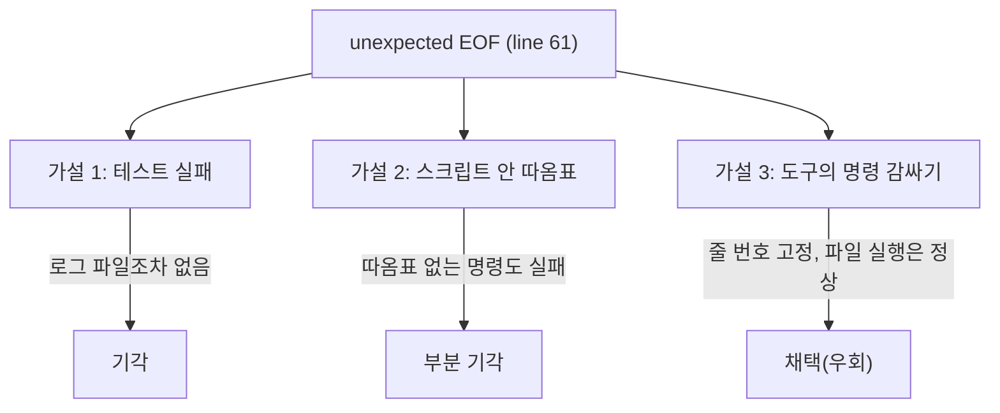
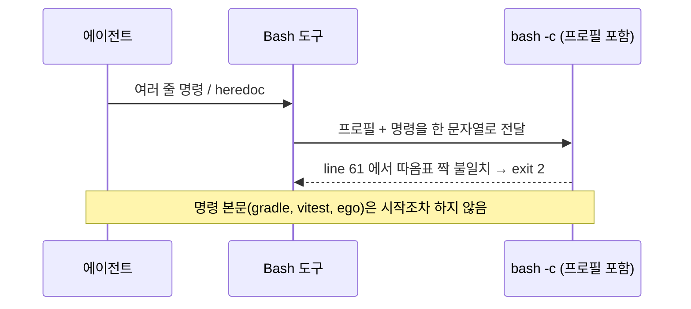

# 에이전트 Bash 도구에서 heredoc·여러 줄 명령이 `unexpected EOF` → 명령을 파일로 써서 실행

| 항목 | 내용 |
| --- | --- |
| 날짜 | 2026-11-03 (그 전 세션에서도 여러 번) |
| 프로젝트 | JobSight v0.0.6 |
| 환경 | Windows 11, Claude Code Bash 도구(Git Bash), ego-browser 2.2.0, Docker Desktop |
| 분류 | 환경·호환성 |
| 영향 | 에이전트가 검증 명령을 돌릴 때만. 사용자 터미널·앱 동작과는 무관. 실행 전 파싱 실패라 **테스트 실패로 오인**하기 쉽다 |

## 요약

- 문제: heredoc 이나 `\` 줄 잇기 여러 줄 명령이 `unexpected EOF while looking for matching` 으로 실행 전에 죽는다.
- 원인: 미확정. 도구가 명령을 셸 프로필과 함께 감싸 `bash -c` 로 넘기는 과정에서 따옴표 짝이 깨지는 것으로 보인다(오류가 늘 `line 61` 을 가리킨다).
- 해결(우회): 명령을 파일로 쓰고 그 파일을 실행한다.

## 1. 문제

```text
/usr/bin/bash: -c: line 61: unexpected EOF while looking for matching `''
```

났던 명령:

- 작은따옴표가 든 JS 를 `ego-browser nodejs <<'EOF' … EOF` 로 넘길 때
- 큰따옴표·`\` 줄 잇기가 섞인 docs/local-dev.md 의 백엔드 전체 테스트 `docker run …` 을 그대로 넘길 때(백그라운드 실행, exit 2)
- `cp … && git show … > … && npx vitest … ; grep -E "FAIL|Tests "` 같은 한 줄 명령에서도 났다

## 2. 원인 파악 과정

| # | 가설 | 확인 방법 | 결과 |
| --- | --- | --- | --- |
| 1 | 테스트·빌드가 실패했다 | 출력에 Gradle·vitest 출력이 전혀 없고 `backend/test.log` 가 생기지 않음 | 기각: 명령 본문이 실행되지 않았다 |
| 2 | 스크립트 안 작은따옴표가 heredoc 을 깨뜨린다 | 따옴표를 바꿔도 같은 오류. 따옴표 없는 줄에서도 남 | 부분 기각: 따옴표만의 문제가 아니다 |
| 3 | 도구가 명령을 감싸는 과정에서 깨진다 | 오류 줄 번호가 명령 길이와 무관하게 늘 `line 61`. 같은 내용을 파일로 쓰고 `bash 파일` / `ego-browser nodejs < 파일` 로 돌리면 정상 | 채택(우회 근거). 감싸는 방식 자체는 확인하지 못함 |



## 3. 원인

근본 원인은 확정하지 못했다. 관찰 사실만 적는다.



## 4. 해결 시도

### 시도 1: 따옴표 바꾸기

- 가설: 작은따옴표를 큰따옴표로 바꾸면 heredoc 이 안 깨진다.
- 결과: 실패. 따옴표 없는 명령에서도 재발.

### 시도 2: 명령을 파일로 쓰고 실행

- 가설: 도구가 감싸는 문자열을 짧은 한 줄로 만들면 깨질 곳이 없다.
- 변경: EGO 는 `ego-browser nodejs < /절대경로/round-NN.mjs`(ego-browser 안내서의 cmd 방식과 같다), 셸은 `bash /절대경로/script.sh`.
- 결과: 성공. 백엔드 전체 테스트 `exit=0, BUILD SUCCESSFUL`, EGO 라운드 정상.

### 함께 겪은 함정: 파일 쓰기가 막혔는데 실행이 돌아 127

파일 쓰기(Write)를 훅(Fact-Forcing Gate)이 거절했는데, 같은 응답에 묶어 보낸 실행이 그대로 돌아
`No such file or directory`(exit 127)가 났다. 이 세션에서 두 번 겪었다.

```text
bash: …/scratchpad/redeploy_smoke.sh: No such file or directory   (exit 127)
```

## 5. 최종 해결과 검증

```text
# 우회 후
bash /c/Users/<user>/…/scratchpad/backend_test.sh   → exit=0, BUILD SUCCESSFUL, tests=279 failures=0 errors=0
ego-browser nodejs < C:/Users/<user>/…/scratchpad/ego/round-03.mjs → 정상 출력
```

## 6. 배운 점과 예방책

- 교훈: 명령이 "실패"했을 때 **본문이 실행됐는지부터** 본다(로그 파일·도구 출력 유무). 파싱 실패를 테스트 실패로 보고하지 않는다.
- 예방책: 여러 줄·따옴표가 섞인 명령은 처음부터 파일로 쓰고 실행한다. 파일을 쓰는 호출과 실행 호출은 같은 응답에 묶지 말고, 쓰기 성공을 본 뒤 실행한다.
- 관련 CS 개념: 셸 인용(quoting)과 토큰화, 프로세스 종료 코드의 의미(2 = 사용법·파싱 오류, 127 = 명령 없음)

## 참고

- docs/local-dev.md 「backend 전체 테스트」 명령
- AGENTS.md 「검증 절차 규칙」 — 종료코드를 직접 읽는다
