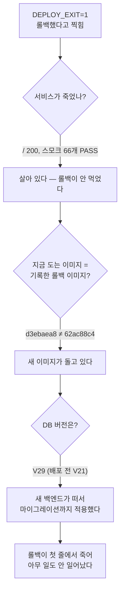
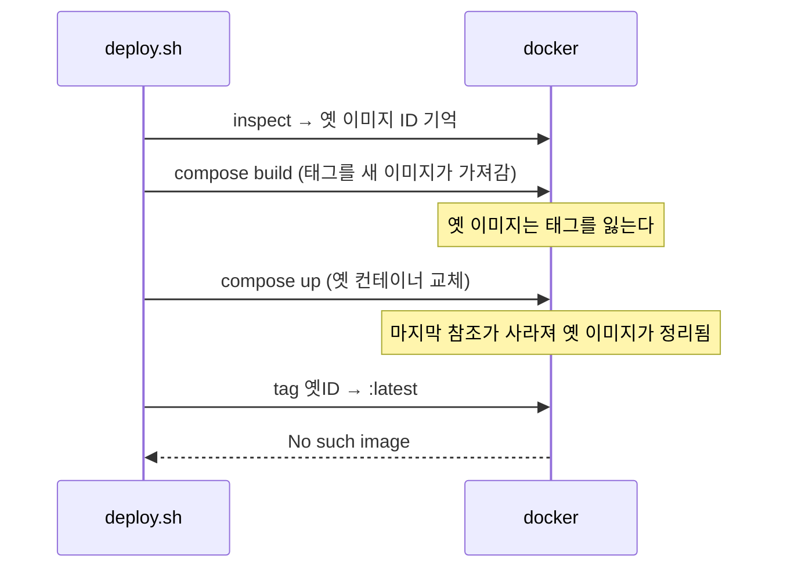

# 스모크 1개 실패로 롤백이 돌았는데 `No such image` 로 죽음 → 롤백 지점을 ID 로만 잡았다

| 항목 | 내용 |
| --- | --- |
| 날짜 | 2026-11-03 |
| 프로젝트 | JobSight v0.0.6 (`feat/github-actions-cd`) |
| 환경 | 운영 스택 `jobsite-v006`(compose.yaml + compose.mcp.yaml), 공개 `https://job.donyk.link` |
| 분류 | 버그 (배포 스크립트) |
| 상태 | 해결 |

## 요약

`scripts/deploy.sh` 의 첫 실제 운영 배포에서 스모크 66개 중 **1개**가 연결 실패로 떨어졌다.
스크립트는 설계대로 롤백에 들어갔으나 첫 `docker tag` 에서 `No such image` 로 죽었다.
**롤백이 아무것도 못 한 덕분에** 새 코드가 그대로 살아남았고, 곧바로 다시 돈 스모크는 66개 전부 통과했다.

즉 결과는 정상이었지만 두 가지가 동시에 틀렸다. 스모크가 일시적 실패를 배포 실패로 단정했고, 롤백은 실행 자체가 불가능한 상태였다.
그리고 이 배포는 마이그레이션(V21 → V29)을 포함했으므로, **롤백이 성공했다면 오히려 장애가 났다.**

## 1. 증상

```
  FAIL  GET OAuth server metadata                        expected=200 actual=000
FAIL  — 위의 FAIL 항목을 고치기 전에는 배포하지 않는다.
SMOKE_EXIT=1

== 롤백 — 직전 이미지로 되돌린다
Error response from daemon: No such image: sha256:d9c858585cbd2c2f840bdd6b69189a3dd5083bd3a57769a162def9eff2c065a9
DEPLOY_EXIT=1
```

`actual=000` 은 HTTP 상태가 아니라 curl 이 연결 자체를 못 했다는 뜻이다. 나머지 65개는 통과했다.

## 2. 원인 파악



결정적 단서는 **DB 버전**이었다. 롤백이 됐다면 옛 백엔드가 떠 있어야 하는데 스키마가 V29 였다.

## 3. 원인

두 개가 겹쳤다.

**(a) 롤백 지점을 이미지 ID 로만 기록했다.**



기억한 것은 ID 뿐인데, 그 ID 를 살려 두는 장치가 없었다. 태그는 빌드가 가져가고 컨테이너 참조는 교체가 끊는다.

**(b) 스모크를 한 번만 보고 단정했다.** 컨테이너를 막 교체한 직후라 앞단 프록시의 upstream 재해석(`docs/nginx-deploy.md` 「resolver」)이 끝나기 전이었다. 한 요청이 연결에 실패했고 재실행에서는 즉시 통과했다.

여기에 더해, 이 배포는 마이그레이션을 포함했다. 롤백이 **성공했다면** 옛 코드가 V29 스키마를 만나 `ddl-auto: validate` 에서 기동 실패했을 것이다. 롤백이 깨져 있던 것이 장애를 막은 셈이다.

## 4. 해결 시도

- `deploy.log` 의 롤백 구간만 보고 "롤백됐다"고 읽을 뻔했다. 실행 중인 이미지 ID 와 DB 버전을 직접 보고서야 반대임을 알았다. **스크립트가 찍은 문장이 아니라 시스템 상태를 봐야 한다.**

## 5. 최종 해결과 검증

`scripts/deploy.sh` 를 네 군데 고쳤다.

1. **롤백 지점을 기록하는 순간 태그를 박는다** — `jobsite-v006-<svc>:rollback-<타임스탬프>`. 태그가 있으면 정리되지 않는다. 2026-10-31 드롭다운 배포에서 사람이 손으로 하던 방식(`pre-dropdown-...`)과 같다.
2. **롤백 함수가 첫 실패에서 죽지 않는다** — 함수 안에서만 `set +e`, 서비스별 성공·실패를 찍고 마지막에 종합 결과를 돌려준다.
3. **스모크는 실패 시 20초 뒤 한 번 더 본다** — 되돌리는 쪽이 더 위험하므로 일시적 흔들림에 반응하지 않는다.
4. **마이그레이션이 적용된 배포는 자동 롤백하지 않는다** — DB 의 `flyway_schema_history` 최대 버전과 저장소의 `V*.sql` 최대 번호를 비교해 판정하고, 보류 중이었으면 롤백 대신 상태와 선택지를 찍고 종료코드 1 로 멈춘다. git diff 로 보면 이미 pull 된 트리를 재배포하는 경우를 놓치므로 DB 를 직접 본다.

검증: DB V29 = 저장소 V29 상태에서 판정이 `MIGRATION_PENDING=no` 로 나오는 것, 롤백 태그가 실제로 박히고 지워지는 것, 고친 스크립트로 재배포가 끝까지 통과하는 것을 확인했다.

## 6. 배운 점

- **롤백 지점은 "기억"이 아니라 "고정"이어야 한다.** ID 를 적어두는 것은 기억일 뿐이고, 태그를 박아야 고정이다.
- **자동 롤백이 항상 더 안전한 것은 아니다.** 스키마가 앞서 나간 뒤에는 되돌리는 쪽이 장애다. 되돌릴 수 없는 것이 섞인 배포는 멈추고 사람을 부르는 게 맞다.
- **일시적 실패 하나로 운영을 되돌리지 않는다.** 교체 직후의 연결 실패는 프록시 재해석 때문일 수 있다.
- 배포 스크립트의 로그 문장을 결과로 믿지 않는다. 이미지 ID 와 스키마 버전이 사실이다.

## 참고

- [../nginx-deploy.md](../nginx-deploy.md) 「배포」 — 자동 롤백의 한계
- [../decisions.md](../decisions.md) — 배포 스크립트가 빌드를 먼저 끝내는 이유
