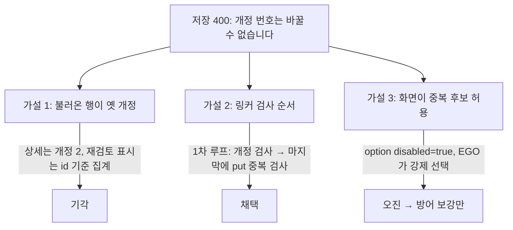
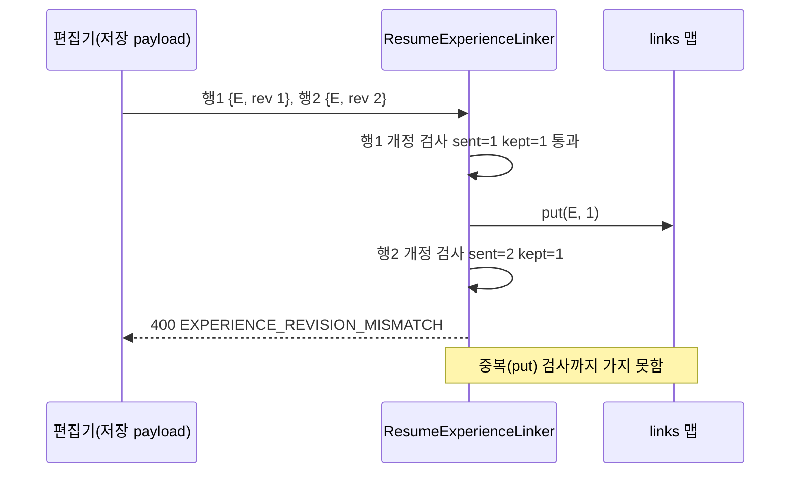

# "경험에서 불러오기" 뒤 저장 400 "개정 번호는 바꿀 수 없습니다" → 중복 연결 검사가 개정 검사 뒤에 있었음

| 항목 | 내용 |
| --- | --- |
| 날짜 | 2026-11-03 |
| 프로젝트 | JobSight v0.0.6 (`fix/experience-load-duplicate`) |
| 환경 | Windows 11, Docker Desktop 워크트리 compose(8089), Spring Boot 4.1 / Java 21, Vue 3 + vitest 4.1, EGO Lite(ego-browser 2.2.0) |
| 분류 | 버그 |
| 영향 | 같은 이력서에 같은 경험을 두 행으로 실은 저장(웹 PUT·MCP 행 도구 공통 경로). 사용자에게 엉뚱한 오류 사유를 보여 줌. 데이터 손상 없음(저장 자체가 거절됨) |

## 요약

- 문제: 이미 경험 E 에 연결된 행이 있는 이력서에서 E 를 다시 불러와 저장하면 "경험 행의 개정 번호는 바꿀 수 없습니다" 400.
- 원인: 링커가 같은 경험 두 행(`EXPERIENCE_ROW_DUPLICATE`)을 개정 검사 **뒤**에 봐서, 둘째 행의 다른 개정이 먼저 `EXPERIENCE_REVISION_MISMATCH` 로 터졌다. 입력 자체는 화면이 `disabled` 로 막는 값을 자동화 도구가 강제로 넣은 것이었다.
- 해결: 링커에서 중복을 먼저 검사하고, 편집기 `loadFromExperience` 도 이미 연결된 경험이면 행을 붙이지 않는다.

## 1. 문제

EGO 브라우저로 화면 흐름(가져오기 → 검토 확정 → 정정 → 재검토 → 불러오기)을 자동 검증하던 중 났다.

재현:

1. 이력서에 프로젝트 행을 쓰고 저장 → 경험 화면 "이력서에서 가져오기"로 경험 E 생성. 행은 E 개정 1 에 연결.
2. E 의 결과 사실을 고쳐 CORRECT 개정 2 를 만든다.
3. 이력서 편집기를 다시 열고 프로젝트 섹션 "경험에서 불러오기"에서 E 를 고른 뒤 저장.

```text
경험 행의 개정 번호는 바꿀 수 없습니다(ef0e51f7-…). 원본으로 갱신은 웹 '원본으로 갱신'(refreshExperienceIds)으로 합니다.
```

새로 불러온 2행에도 "재검토 필요"가 붙어 보였고, 서버에는 1행만 남아 있었다(`GET /api/resumes/{id}` 의 `projects` 1건).

## 2. 원인 파악 과정

| # | 가설 | 확인 방법 | 결과 |
| --- | --- | --- | --- |
| 1 | 불러온 행이 옛 개정(1)을 달고 나가 개정 검사에 걸렸다 | 정정 뒤 페이지를 새로 열었으므로 편집기가 받은 상세는 개정 2 여야 한다. 2행의 "재검토 필요"는 `ResumeEditor.staleIds` 가 **경험 id 기준**으로 모으기 때문(1행이 개정 1) | 기각: 개정은 맞게 실렸다. 표시는 id 기준 집계의 부산물 |
| 2 | 링커가 이 입력을 개정 문제로 잘못 분류한다 | `ResumeExperienceLinker.link` 1차 루프 읽기: 개정 검사(`sent ≠ kept` → MISMATCH) 뒤 마지막 `put()` 에서야 중복 검사 | 채택: 둘째 행 `sent=2, kept=1` 이 중복보다 먼저 MISMATCH |
| 3 | 화면이 이미 연결된 경험을 불러오기 후보로 허용한다 | EGO 로 뽑은 선택지 목록에는 `disabled` 를 출력하지 않았다. `ResumeSection.vue:74` `used` 를 읽고 다시 뽑아 보니 해당 옵션 `disabled: true` | **오진**: 사람은 못 고른다. EGO `selectOption()` 이 disabled 옵션을 강제로 골랐다. 단 받는 함수(`loadFromExperience`)는 막힌 값도 그대로 행을 붙였다 |



## 3. 원인

한 이력서에서 같은 경험을 두 행에 잇는 것은 금지(`EXPERIENCE_ROW_DUPLICATE`)인데, 링커가 행마다 개정부터 검사하고
중복은 링크 맵에 넣을 때(`put`) 봤다. 첫 행이 `links[E]=1` 을 넣은 뒤 둘째 행이 `experienceRevision: 2` 를 실어 오면
저장값 `kept=1` 과 달라 개정 검사에서 먼저 예외가 난다. 둘째 행이 개정 없이 오거나 같은 개정이면 중복 메시지가 나왔으므로
**"다른 개정을 실은 둘째 행"** 에서만 원인이 가려졌다.

```text
backend/src/main/java/com/jobsight/company/resume/ResumeExperienceLinker.java (수정 전)
134  Integer sent = row.revision();
135  Integer kept = storedRevisions.get(id);
...
141  } else if (kept != null) {
142      if (!sent.equals(kept)) throw revisionMismatch(id);   // ← 둘째 행이 여기서 먼저 터짐
...
153  put(links, id, revision);                                 // ← 중복 검사는 여기
```



## 4. 해결 시도

### 시도 1: 화면 선택지에서 이미 쓴 경험을 빼기

- 가설: 불러오기 후보에 연결된 경험이 보여서 생긴 일이다.
- 변경: 하지 않음.
- 결과: `ResumeSection.vue` 가 이미 `:disabled="used.has(line.id)"` 로 막고 있었다(가설 3 오진). 선택지를 빼는 대신 받는 함수에서 거르기로 했다.

### 시도 2: 링커 검사 순서 바꾸기 + 편집기 함수 방어

- 가설: 근본 규칙(중복)을 먼저 보면 어떤 개정을 실어 와도 정확한 사유가 나온다.
- 변경: 아래 최종 diff.
- 결과: 같은 입력에 `EXPERIENCE_ROW_DUPLICATE`. 편집기는 행을 붙이지 않고 안내.

## 5. 최종 해결과 검증

```diff
--- a/backend/src/main/java/com/jobsight/company/resume/ResumeExperienceLinker.java
+++ b/backend/src/main/java/com/jobsight/company/resume/ResumeExperienceLinker.java
@@ -133,2 +133,4 @@
             }
+            // 중복을 개정보다 먼저 본다. 같은 경험을 다른 개정으로 실은 두 번째 행이 '개정을 바꿀 수 없다'로 잘못 거절됐다.
+            if (links.containsKey(id)) throw duplicateRow(id);
             Integer sent = row.revision();
@@ -152,3 +154,3 @@
-            put(links, id, revision);
+            links.put(id, revision);
@@ -183,7 +185,5 @@
-    private static void put(Map<UUID, Integer> links, UUID id, int revision) {
-        if (links.putIfAbsent(id, revision) != null) {
-            throw new ApiRuleException(HttpStatus.BAD_REQUEST, "EXPERIENCE_ROW_DUPLICATE", …);
-        }
+    private static ApiRuleException duplicateRow(UUID id) {
+        return new ApiRuleException(HttpStatus.BAD_REQUEST, "EXPERIENCE_ROW_DUPLICATE", …);
     }
--- a/frontend/src/components/ResumeEditor.vue
+++ b/frontend/src/components/ResumeEditor.vue
@@ -112,2 +112,7 @@ async function loadFromExperience(key: SectionKey, id: string) {
   experienceError.value = ''
+  // 선택지는 이미 쓴 경험을 disabled 로 막지만, 막힌 값이 들어와도 저장 400(EXPERIENCE_ROW_DUPLICATE) 전에 여기서 멈춘다.
+  if (anchoredIds(content.value).includes(id)) {
+    experienceError.value = '이미 이 이력서의 행에 연결된 경험입니다. 한 이력서에서 경험 하나는 한 행에만 씁니다.'
+    return
+  }
```

```text
# 수정 전 소스로 새 프런트 테스트 실행 → 실패 확인
before_exit=1  FAIL ResumeExperience.spec > 이미 이 이력서에 연결된 경험은 고를 수 없고, …   (2 failed | 25 passed)
# 수정 후
npm run type-check → exit 0
npm test → Test Files 29 passed, Tests 190 passed, exit 0
backend: ./gradlew compileJava compileTestJava test → exit=0, BUILD SUCCESSFUL, tests=279 failures=0 errors=0
docker compose up -d --build --wait backend frontend → up_exit=0;  bash scripts/smoke.sh http://127.0.0.1:8089 → PASS (65 checks)
# EGO 재확인: 옵션 disabled=true, 강제로 골라도 행 수 1 유지, 알림 "이미 이 이력서의 행에 연결된 경험입니다. …"
```

추가한 테스트:

- `ExperienceBankIntegrationTest.linkerRejectsForeignWrongSectionAndDuplicateExperiences` — 개정 1·2 를 실은 같은 경험 두 행 → `EXPERIENCE_ROW_DUPLICATE`. 수정 전 백엔드로 실패를 따로 돌려 보지는 않았다(미측정). 수정 전 코드 경로상 MISMATCH 가 나는 입력이다.
- `ResumeExperience.spec` "이미 이 이력서에 연결된 경험은 고를 수 없고, 막힌 값이 들어와도 행을 붙이지 않고 알린다" — 회귀 테스트(수정 전 실패 확인).

## 6. 배운 점과 예방책

- 교훈: 검사가 여럿이면 **더 근본적인 규칙을 먼저** 본다. 뒤 검사의 메시지가 앞 원인을 가리면 디버깅이 엉뚱한 곳으로 간다.
- 교훈: 자동화 도구가 넣은 값이 **사람이 넣을 수 있는 값인지** 먼저 본다. EGO `selectOption()` 은 `disabled` 옵션도 고른다.
- 예방책: UI 속성(`disabled`)에만 기대지 말고 값을 받는 함수에서도 거른다. E2E 로 선택지를 뽑을 때 `disabled`·`hidden` 도 함께 출력한다.
- 관련 CS 개념: 검증 순서와 오류 우선순위(fail-fast), 다층 방어(defense in depth), 클라이언트 검증 vs 서버 검증의 신뢰 경계

## 참고

- docs/experiences.md 「함정」 첫 줄, 불변 조건 3(개정은 클라이언트가 바꾸지 못한다)
- `frontend/src/components/ResumeSection.vue` 의 `used`(이미 쓴 경험 disabled)
- 같은 날 화면 검증에서 함께 나온 [저장 성공 뒤 옛 오류 문구](2026-11-03-resume-save-stale-error-notice.md)
