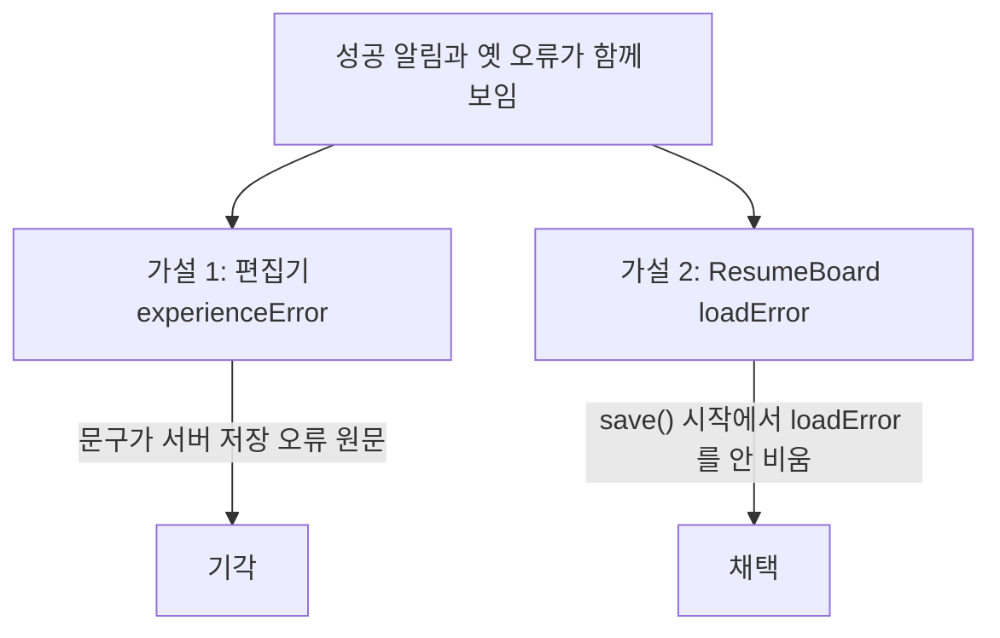
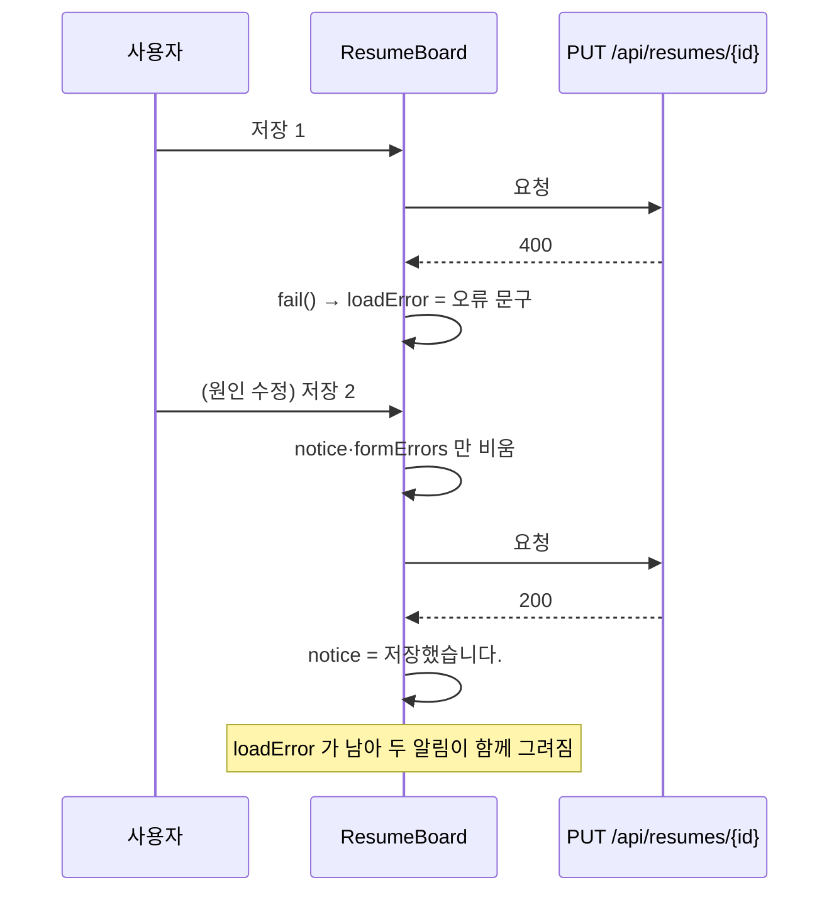

# 저장 성공 뒤에도 앞선 저장 실패 문구가 남음 → save() 가 loadError 를 비우지 않음

| 항목 | 내용 |
| --- | --- |
| 날짜 | 2026-11-03 |
| 프로젝트 | JobSight v0.0.6 (`fix/experience-load-duplicate`) |
| 환경 | Vue 3 + vitest 4.1, 워크트리 compose(8089), EGO Lite |
| 분류 | 버그 |
| 영향 | 이력서 편집기 상단 알림. 저장은 정상인데 실패처럼 보여 사용자가 같은 저장을 반복할 수 있음 |

## 요약

- 문제: 저장 실패 → 원인 수정 → 다시 저장(성공) 뒤 "저장했습니다."와 **옛 오류 문구가 함께** 보인다.
- 원인: `ResumeBoard.save()` 가 시작할 때 `notice`·`formErrors` 만 비우고 `loadError` 는 비우지 않는다.
- 해결: `save()`·`copy()` 시작에서 `loadError` 도 비운다.

## 1. 문제

[같은 경험 중복 연결 400](2026-11-03-experience-duplicate-row-masked-by-revision-error.md) 을 본 뒤 원인 행을 지우고 다시 저장했을 때
EGO 로 읽은 알림 영역:

```text
[ '저장했습니다.', "경험 행의 개정 번호는 바꿀 수 없습니다(ef0e51f7-…). 원본으로 갱신은 웹 '원본으로 갱신'(refreshExperienceIds)으로 합니다." ]
```

## 2. 원인 파악 과정

| # | 가설 | 확인 방법 | 결과 |
| --- | --- | --- | --- |
| 1 | 편집기 안 `experienceError` 가 남았다 | `ResumeEditor.vue` 의 `experienceError` 는 `.page-notice` 안 `notice error` — 불러오기·등록에서만 씀. 남은 문구는 서버 저장 오류 원문 | 기각 |
| 2 | 상위 `ResumeBoard` 의 `loadError` 가 남았다 | `fail()` 이 필드 오류 없는 API 오류를 `loadError` 에 넣고, `save()` 는 `loadError` 를 비우지 않음 | 채택 |



## 3. 원인

```text
frontend/src/components/ResumeBoard.vue (수정 전)
48  function fail(error, fallback) { … if (필드 오류 없음) loadError.value = error.message … }
115 async function save(payload) {
119   formErrors.value = {}
120   notice.value = ''          // ← loadError 는 그대로
128   notice.value = '저장했습니다.'
```



## 4. 해결 시도

### 시도 1: 저장·복제 시작에서 loadError 비우기

- 가설: 새 동작을 시작할 때 이전 동작의 알림 상태를 전부 비우면 된다.
- 변경: 아래 diff. `copy()` 도 같은 구조라 함께 고쳤다.
- 결과: 실패 → 성공 순서에서 성공 알림만 남는다.

## 5. 최종 해결과 검증

```diff
--- a/frontend/src/components/ResumeBoard.vue
+++ b/frontend/src/components/ResumeBoard.vue
@@ -120,2 +120,4 @@ async function save(payload: ResumePayload) {
   notice.value = ''
+  // 앞선 저장 실패 문구를 지운다. 남겨 두면 성공한 저장 뒤에도 '저장했습니다'와 옛 오류가 함께 보인다.
+  loadError.value = ''
   try {
@@ -140,2 +142,3 @@ async function copy() {
   notice.value = ''
+  loadError.value = ''
   try {
```

```text
# 수정 전 소스로 실행
before_exit=1  FAIL ResumeBoard.spec > 이력서 편집기 열기 > 저장이 실패한 뒤 다시 저장해 성공하면 옛 오류 문구가 사라진다
# 수정 후
npm run type-check → exit 0;  npm test → Tests 190 passed, exit 0
bash scripts/smoke.sh http://127.0.0.1:8089 → PASS (65 checks)
```

회귀 테스트: `ResumeBoard.spec` "저장이 실패한 뒤 다시 저장해 성공하면 옛 오류 문구가 사라진다"(수정 전 실패 확인).
실제 화면에서 실패 → 성공 순서를 다시 만들어 보지는 않았다(미측정 — 지금은 같은 400 을 화면에서 만들 길이 막혔다).

## 6. 배운 점과 예방책

- 교훈: 한 화면이 알림 상태를 여러 개(`notice`·`loadError`·`formErrors`) 가지면, 새 동작을 시작할 때 **전부** 비우는지 본다.
- 예방책: 저장 흐름 테스트는 성공만이 아니라 "실패 → 성공" 순서를 하나 둔다.
- 관련 CS 개념: UI 상태 관리(파생되지 않은 중복 상태의 동기화)

## 참고

- [같은 경험 중복 연결이 개정 오류로 가려짐](2026-11-03-experience-duplicate-row-masked-by-revision-error.md)
